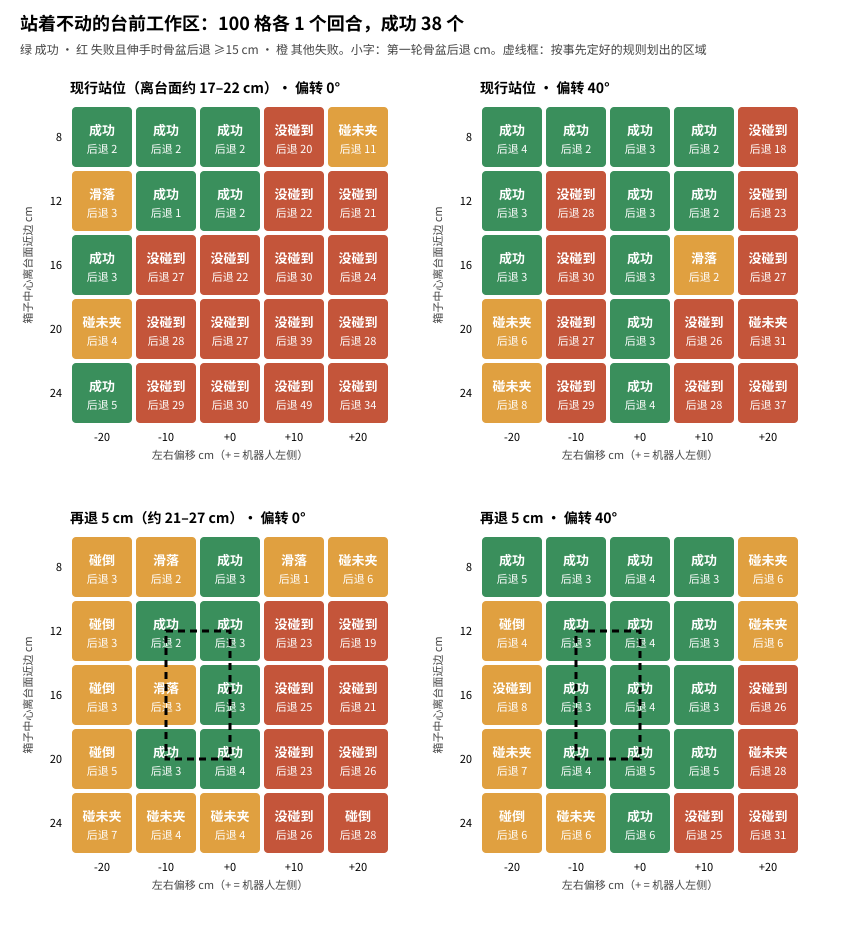

# 实验一续 · 站着不动的工作区、区域验收和移动箱子（2026-11-24 至 25）

**结论：在“机器人站着不挪步、箱子只在 10 cm 内往复”的设定下，阻塞式做法要么第一轮就抓到，要么就再也抓不到；成败取决于合手那一刻箱子离锁存位置有多远，而不是延迟本身。** 左右挪了 3 cm 以内时一轮成功 83%，3–5 cm 时 61%，5–8 cm 时 42%；合计挪动超过 8 cm 时 13 轮只成功 2 轮。按计划的判定：短延迟 0.03 m/s 比静态低 26.7 个百分点，失败集中在“错过目标”且重试 0/10 救回，问题 A 在这一档成立；其余五个移动条件都在静态成功率的 80% 以上，算“主要损失速度”。所有结论只对厘米级的位移成立。

| 延迟（控制步） | 静态 | 往复 0.03 m/s | 往复 0.10 m/s | 成功回合用时中位 |
|---|---|---|---|---|
| 短（75，本地 Qwen 1.37 s） | 28 / 30 | 20 / 30 | 23 / 30 | 6.8 s |
| GPT-6.2 Astra（194，3.88 s） | 27 / 30 | 27 / 30 | 26 / 30 | 9.2 s |
| Gemini 4 Argon（383，7.66 s） | 27 / 30 | 23 / 30 | 22 / 30 | 13.0 s |

八个动态条件里所有成功都发生在第一轮。第一轮失败的 42 个回合一个也没救回来。

## 这份记录改了原计划的哪些地方

计划“实验一”一节的动态部分，2026-11-25 用户确认后做了下面这些修改：

- 机器人全程站在台前不挪步（走路落点误差 ±10 cm，侧步和后退基本不可用，见实验二的记录）。所以只测站着能够到的范围。
- 箱子只在按规则划出的区域里往复。这个区域左右只有 10 cm 宽，结论只对厘米级位移成立。
- 速度只做 0.03 和 0.10 m/s。0.30 m/s 不做：在 10 cm 的线段上它和 0.10 一样只是来回抖。
- 延迟三档：75 / 194 / 383 个控制步，分别是本地 Qwen、GPT-6.2 Astra、Gemini 4 Argon 在实验三里实测的中位数（Qwen 实测 1.37 s，按原计划的 1.5 s 取整）。
- “中途换目标”不做：两个物体要相距 50 cm，站着不挪步够不到。
- 区域内的静态验收同时作为短延迟的静态基线，没有重跑。
- 主要分析加了“位移对成功率”和三项追加分析（口径见最后一节，在看数据之前提交）。

判定阈值没有改：移动条件达到同延迟静态成功率的 80% 算“主要损失速度”；比静态低 25 个百分点以上时，看失败是否集中在错过目标或来不及重试。三档延迟分开判。每格 30 次，只认 25 个百分点以上的差距。

## 第一步：站着不动时够得着哪里

机器人直接放在台前站稳，从头到尾不挪步；每轮仍然“锁存、等 75 步、伸手、合手、抬起”，失败就重试，直到成功或 1450 步时限。网格 100 格，每格一个回合（提交 c954487，运行名 `exp1-map-20261124-m1-*`）：

- 箱子中心离台面近边：8、12、16、20、24 cm
- 相对机器人正前方的左右偏移：-20、-10、0、+10、+20 cm（+ 是机器人左侧）
- 偏转角：0° 和 40°
- 机器人离台面：现行站位规则（落地后实测 17–22 cm），以及再往后 5 cm（实测 21–27 cm）

结果见 [stance-map-20261124.svg](stance-map-20261124.svg)：100 格成功 38 个。



三个问题的答案：

1. **深度规律在新数据上成立。** 现行站位、左右偏移在 10 cm 以内时，箱子深 8–12 cm 的 12 个回合成功 9 个；深 16–24 cm 的 18 个只成功 3 个，其中 14 个伸手时骨盆后退了 22–49 cm。
2. **站远 5 cm 能救回深 16–20 cm 的箱子，救不回 24 cm 的。** 深 16–20 cm、左右 10 cm 以内的 12 个回合，成功数从 2 个升到 9 个，后退 15 cm 以上的从 9 个降到 2 个。深 24 cm 站远后仍只成功 1 / 6：2 个仍是伸手时后退（25–26 cm），3 个是碰到没夹住（判定截止时手腕还差 3–8 cm），手伸不够长。
3. **不挪步时可靠的左右范围只有约 10 cm，而且偏向机器人右侧。** 站远 5 cm 时：正前方 9 / 10，右 10 cm 6 / 10，左 10 cm 4 / 10，左右 20 cm 合计 1 / 20。左 10 cm 的 6 个失败里 5 个是伸手时骨盆后退 23–26 cm；右 20 cm 的失败是碰倒或碰到没夹住，骨盆不后退。

站位用了“再退 5 cm”这一档。“伸手时后退”在这一档、区域之内基本消失（区域内 12 个回合后退都在 5 cm 以内），所以没有再试髋部前倾之类的修法。

## 第二步：划区域和新种子验收

区域按看结果之前写进代码的规则（`report_grasp.py --pick-region`，提交 cb3f8b1）挑出：两档站位各找一个格子最多、两个偏转角合起来成功率不低于 90% 的矩形，再把矩形外沿每边往里收半格（只覆盖测过的格点之间）。结果是：**站位比现行规则再退 5 cm，箱子深 12–20 cm、左右 -10 到 0 cm**。框内 12 个回合成功 11 个。写进 `configs/grasp-loop.json` 的 `stand` 一节（提交 c17ac25），之后没有改。

验收用 30 个新种子（6000–6029），箱子在区域内均匀随机摆放、偏转 ±45°，从台前起步，只评一次（提交 6e07679，运行名 `exp1-region-20261124-r1-*`）：

| 项目 | 数值 |
|---|---|
| 回合成功 | **28 / 30，过线**（门槛 26） |
| 第一轮成功 | 26 / 30 |
| 失败 | 6005、6007：第一轮碰到没夹住，箱子被推开；之后两轮手腕离目标 28–33 cm，机器人不挪步，够不到 |
| 成功回合用时中位 | 6.8 s |

## 第三步：箱子在动

### 怎么动

箱子沿左右方向在区域两端之间往复（离机器人正前方 -10 到 0 cm，深度不变），到端点折返；种子决定起始位置和方向。首轮锁存时启动驱动，每个控制步把箱子放到脚本给的位置并给它脚本的速度。第一次检测到手与箱子接触时撤掉驱动，之后箱子只由物理决定：不清零速度，不锁定，重试时也不恢复驱动。全部 240 个回合都在第一轮就撤了驱动。

三个调试种子（1000–1002）上核对过轨迹、折返和撤驱动，轨迹图在开发机备份的 `scratch/track-dbg.png`。

每轮的做法和静态完全一样：读一次箱子位姿锁存，原地等固定延迟，再伸手、合手、抬起，整段结束才刷新目标。所有条件用同一组种子 6000–6029 和同样的 1450 步时限（提交 ebd2a11，运行名 `exp1-*-20261125-d1-*`）。

### 判定（按计划原文）

| 延迟 | 静态 | 80% 线 | 0.03 m/s | 0.10 m/s | 判定 |
|---|---|---|---|---|---|
| 短 | 93.3% | 74.7% | 66.7%（-26.7） | 76.7%（-16.7） | 0.03：问题 A 成立；0.10：主要损失速度 |
| GPT | 90.0% | 72.0% | 90.0%（0） | 86.7%（-3.3） | 都是主要损失速度 |
| Gemini | 90.0% | 72.0% | 76.7%（-13.3） | 73.3%（-16.7） | 都是主要损失速度 |

短延迟 0.03 m/s 那一档的失败归因：第一轮失败 10 个，9 个是“碰倒”。合手那一刻箱子离锁存位置左右 3–7 cm，手照锁存的位置合拢，拳头落在箱子上把它推倒；骨盆后退都在 3–5 cm 的正常范围，不是执行问题。之后的重试 0 / 10 救回：箱子倒了或被推出可够范围，机器人又不挪步。所以失败集中在“错过目标”，后面的重试也救不回来，按计划这一档问题 A 成立。只超过 25 个百分点线 1.7 个点，每格 30 次，这个结论是勉强的。

其余移动条件的第一轮失败也几乎都是同一种“错过目标后碰倒”（每档 2–7 个），只是数量没多到越线。没有一个移动条件是滑落或后退主导。

计划要求报告“首次达到降幅的速度档及其相邻较慢档”。这里最低的非零档 0.03 m/s 在短延迟下就已经越线，而 0.10 m/s 反而没有，曲线不单调，按实测报告，不推临界速度。原因见下一节。

### 为什么延迟越长不一定越差：看的是合手时箱子在哪

| 条件 | 第一轮合手时箱子离锁存位置（平均） | 第一轮成功 |
|---|---|---|
| 短 0.03 | 5.7 cm | 20 / 30 |
| 短 0.10 | 4.8 cm | 23 / 30 |
| GPT 0.03 | 2.3 cm | 27 / 30 |
| GPT 0.10 | 1.9 cm | 26 / 30 |
| Gemini 0.03 | 5.4 cm | 23 / 30 |
| Gemini 0.10 | 3.2 cm | 22 / 30 |
| 三档静态 | 0.9–1.0 cm（手把箱子推了一点） | 26–27 / 30 |

10 cm 的线段上，0.03 m/s 来回一趟 6.7 s，0.10 m/s 是 2 s。锁存到合手是“等待 + 2.0 s 伸手 + 约 0.36 s 到位判定”：短延迟 3.9 s，GPT 6.2 s，Gemini 10.0 s。GPT 延迟下 0.03 m/s 恰好接近走完一个来回，箱子合手时多半回到锁存位置附近，所以反而最好。延迟长短通过“合手时箱子在周期里的哪个位置”起作用，这是线段太短带来的混叠，不代表更长的延迟更好。

### 位移对成功率

把八个条件里六个移动条件的所有轮次放在一起，按“合手时（没合手的取到位判定截止时）箱子离锁存位置多远”分档：

| 左右位移 | 轮数 | 成功 | 成功率 | 主要失败 |
|---|---|---|---|---|
| 0–1 cm | 45 | 38 | 84% | 没碰到 3，碰到没夹住 2，碰倒 2 |
| 1–2 cm | 47 | 38 | 81% | 碰到没夹住 5，碰倒 3 |
| 2–3 cm | 34 | 29 | 85% | 碰到没夹住 3，碰倒 2 |
| 3–5 cm | 36 | 22 | 61% | 碰倒 11 |
| 5–8 cm | 33 | 14 | 42% | 碰倒 15 |
| 8 cm 以上 | 1 | 0 | – | 碰倒 |

| 合计位移 | 轮数 | 成功率 |
|---|---|---|
| 0–1 cm | 21 | 71% |
| 1–3 cm | 79 | 91% |
| 3–5 cm | 35 | 71% |
| 5–8 cm | 48 | 56% |
| 8–12 cm | 13 | 15% |

估计：**合手时箱子离锁存位置左右超过约 3 cm，成功率开始掉；超过 5 cm 不到一半；合计超过 8 cm 基本抓不到。** 3 cm 左右正好是张开的手留给箱子侧面的余量（配置里 `open_clearance_m` 3.5 cm）：再偏，合拢的拳头就落在箱子顶面或棱上，把它推倒。0–1 cm 那一档的成功率低于 1–3 cm，是因为它混进了重试轮（被碰倒后静止的箱子，位移接近 0 但已经抓不起来）。这里的位移包括手在接近时推箱子的那一点（静态时也有约 1 cm），不全是脚本运动造成的。

### 时间花在哪

| 条件 | 等待 | 伸手（抬手 + 前伸） | 到位判定 | 第一轮合手时信息年龄 |
|---|---|---|---|---|
| 短延迟 | 1.5 s | 2.0 s | 0.36 s | 3.9 s |
| GPT | 3.88 s | 2.0 s | 0.37 s | 6.2 s |
| Gemini | 7.66 s | 2.0 s | 0.37 s | 10.0 s |

成功的回合全部在第一轮，所以“完成时间”就是延迟加大约 5 s 的固定动作，延迟每增加 1 s，成功用时也增加 1 s。重试从来没有带来过成功（八个条件里第二轮以后伸过手的 22 轮，成功 0），时限内多出来的时间没有用处。延迟的代价全部出在等待上，不在接近或重试上；但它的效果是通过“等待期间箱子挪了多远”体现的，而不是通过时间本身。

## 追加分析一：机器人自己的信号能不能分出“抓稳了”

用 stand-still 的全部运行（地图、区域验收、八个动态条件），合过手的 325 轮：成功 261，碰倒 38，碰到没夹住 14，滑落 12。偶数种子的回合拟合，奇数种子的回合检验（161 / 164 轮）。输入只有手臂 14 个关节的跟踪残差、两臂关节速度、两腕速度、左右残差和与它们的差。

| 时刻 | 最好的单个量（检验 AUC） | 线性分类器检验 AUC | 准确率 | “全猜成功”准确率 |
|---|---|---|---|---|
| **合手后 0.2 s（主结果）** | 右臂残差和 0.68 | **0.70** | 77% | 74% |
| 抬起中段 | 左腕偏航残差 0.79 | 0.92 | 88% | 74% |
| 保持段末尾 | 右臂关节速度 1.00 | 0.99 | 96% | 74% |

**按事先定的线（≤ 0.7 不可行），合手后 0.2 s 只靠本体信号分不出来**（0.696，刚好落在线上）。到抬起中段已经能分开（0.92），到保持段末尾几乎完全分开，但那时箱子已经掉了或倒了，只能用来更早放弃这一轮。保持段末尾的数有偏：成功回合在判成功后 0.5 s 就结束，那一刻手臂是静止的，和失败回合的时刻并不对等，不要拿它当证据。

从以后的批次起，逐步日志里加了机器人实际施加的关节力矩（`applied_torque`，提交 fb05b80），供实验四用。

## 追加分析二：试错的代价

“场景被破坏”= 相邻两轮锁存之间箱子平面位移超过 5 cm、或偏转变化超过 20°、或倒了（竖直轴偏离超过 30°）、或出了划定区域。动态条件下只算撤驱动之后的变化。

| 条件 | 第一轮失败 | 之后救回 | 场景被破坏 | 其中倒了 / 出区域 | 第一轮到第二轮箱子位移 |
|---|---|---|---|---|---|
| 短 静态（区域验收） | 4 | 2 | 4 | 0 / 3 | 1.7–6.2 cm |
| 短 0.03 | 10 | 0 | 10 | 5 / 10 | 7.7 cm – 2.4 m |
| 短 0.10 | 7 | 0 | 7 | 3 / 7 | 8.7 cm – 1.5 m |
| GPT 静态 | 3 | 0 | 3 | 0 / 3 | 2.5–7.0 cm |
| GPT 0.03 | 3 | 0 | 3 | 2 / 3 | 7.0–33 cm |
| GPT 0.10 | 4 | 0 | 4 | 3 / 4 | 6.8–68 cm |
| Gemini 静态 | 3 | 0 | 3 | 0 / 2 | 3.5–7.1 cm |
| Gemini 0.03 | 7 | 0 | 7 | 5 / 7 | 10–39 cm |
| Gemini 0.10 | 8 | 0 | 8 | 5 / 8 | 8.3 cm – 1.9 m |
| 走过去再抓（11-24 静态验收） | 14 | 1 | 3 | 0 / – | 0–15 cm |
| 台前起步（11-24 对照） | 9 | 2 | 1 | 0 / – | 0–9.6 cm |

按“场景完好 / 被破坏”分开：

- 站着不动的九个条件，第一轮失败 49 个，场景全部被破坏，救回 2 个（都在短延迟静态）。区域只有 10 cm 宽，箱子被推开 2 cm 以上就常常出了区域，所以这里的“破坏”多数是“出了区域”；按位移和倒来看，静态条件下推开 2–7 cm、不倒，移动条件下一半以上直接倒了。
- 11-24 的两组（机器人位置不同，不算区域）：场景完好时救回 3 / 19（走过去 1 / 11，台前 2 / 8），场景被破坏时 0 / 4。场景完好也很少救回来，因为第一次失败的原因还在：台前起步那组 9 个里 8 个是“没碰到”（伸手时骨盆后退、手够不到），第二轮还是同样的姿势、同样的够不到；走过去那组主要是停得太远或太近（见 [11-24 的记录](README.md)），重试时站位不变。

结论：**阻塞式的重试几乎没有价值，原因分两种：场景完好时失败原因没变（站位、后退），场景被破坏时箱子已经倒了或出了够得着的范围。** 动作之前先确认、或者失败时不把箱子碰倒，比多试几轮更重要。

## 追加分析三：信息有多旧

见上面“时间花在哪”和“位移对成功率”两节。把所有动态条件的轮次按信息年龄分档：

| 合手时信息年龄 | 轮数 | 成功率 | 合手时箱子平均位移 |
|---|---|---|---|
| 3–4 s（短延迟第一轮） | 60 | 72% | 5.3 cm |
| 6–7 s（GPT 第一轮） | 94 | 83% | 1.8 cm |
| 9–11 s（Gemini 第一轮） | 90 | 80% | 3.2 cm |
| 5–6、8–9、11–12 s（到位判定拖得久的轮、重试轮） | 18 | 11% | 1.9–3.9 cm |

成功率随信息年龄不单调，随位移单调：年龄只通过位移起作用，而在 10 cm 的往复里位移由“周期里的相位”决定。延迟的代价出在等待（2.0 s 伸手和 0.36 s 到位判定三档一样），不出在接近或重试。

## 过程中的问题

- **同时启动的仿真太多会起不来。** 每个仿真都在 DDS domain 1 上建一个参与者，CycloneDDS 默认一台机器最多约 10 个，开发机上同时有我的 10 路和另一个会话的 2–4 路时，新仿真启动报 “create domain error”，前后约 100 次启动失败（不影响任何结果，失败的启动没有回合）。批次中途把并行数从 10 路降到 6 路，没有换代码，整批都在提交 ebd2a11 上。之后的修法是把上限调到 100（`agentic/scripts/oracle_sim_bootstrap.py`，提交 fb05b80），已用一个调试回合验证能正常启动。几个并行的仿真之间只发布状态话题、只订阅命令话题，没有哪个仿真发布命令，所以互相不会串数据。
- 开批次时第一次用 4 张卡，按要求加上 GPU 2 时重启过一次批次；被打断的回合挪到 `infra-failed/` 后重跑。
- 地图批次里有 4 格因为调试回合占着 GPU 3 被跳过，批次结束后用同一个提交补跑。
- 箱子被脚本驱动时离开锁存位置不算“碰倒”（提交 c954487 修正）。

## 怎么复现

```bash
source agentic/env.local.sh
D=agentic/pilot_experiments/experiment1_blocking_grasp
# 地图（100 格），挑区域
python $D/run_grasp_suite.py --group map --tag 20261124-m1 --gpus 2 3 4 5 --per-gpu 2
python $D/report_grasp.py 'exp1-map-20261124-m1-*' --map
python $D/report_grasp.py 'exp1-map-20261124-m1-*' --pick-region
# 区域内静态验收（短延迟静态基线）
python $D/run_grasp_suite.py --group region --tag 20261124-r1 --gpus 2 3 4 5 --per-gpu 2
# 八个动态条件，一个队列
python $D/run_grasp_suite.py --group region --tag 20261125-d1 --gpus 0 3 4 --per-gpu 2 \
  --conditions 0:194 0.03:194 0.1:194 0.03:75 0.1:75 0:383 0.03:383 0.1:383
python $D/report_grasp.py 'exp1-*move0*-20261125-d1-*' --displacement
python $D/analyze_followups.py proprio 'exp1-[mrlx]*-2026112[45]-[rmd]1-*'
python $D/analyze_followups.py retry 'exp1-move003-20261125-d1-*'
python $D/analyze_followups.py age 'exp1-*-20261125-d1-*'
```

单个回合 4–11 分钟。一张 5090 可以并排跑两个（每个约 11 GB）。

## 数据在哪

- 开发机 `KVLA_AGENTIC_RUNS` 下的运行目录，每个有 `grasp-result.json`（每轮标记和 `notes`：骨盆离台面、后退、手腕差距、合手时箱子位置、撤驱动时刻）、`layout.json`（摆放和运动参数）、`grasp-steps.jsonl`、`execution.jsonl`、`rounds.jsonl`、视频。
- 备份：开发机持久盘 `/mnt/cfs/d5bvk6/personal/mingqianzhou/kvla-exp1-stance-dynamic/`（`runs/` 370 个正式运行和 6 个调试运行，`scratch/` 分析输出和轨迹图，`backup-done.txt` 是核对结果）。

## 没做的

- 0.30 m/s 和中途换目标（见上）。
- 区域只有 10 cm 宽，没有测更大的位移；要测更大的移动，先得让机器人能挪步或站位更宽。
- 位移对成功率的分档是把不同条件的轮次合在一起，各档轮数 30–50，分档之间 15 个百分点以内的差别不可信。
- 偏转角只测了 0° 和 40°，验收和动态是 ±45° 随机。

## 事先写定的分析口径（2026-11-25 提交，看数据之前）

三项追加分析只用已有日志，不重跑。默认值由总调度会话提出，用户没有改动。

### 一、本体信号能不能分出“抓稳了”和“没抓稳”

- 输入只用机器人自己读得到的量：关节位置、参考关节角（相减得跟踪残差）、关节速度（由逐步关节位置差分）、手腕速度、合手指令。箱子位姿和接触力只当标签，不进输入。
- 标签：每轮标记“成功”为正类，“碰到没夹住 / 夹住后滑落 / 碰倒”为负类；“没碰到”的轮次单列，不进二分类。只用合过手的轮次。
- 判的时刻：合手后 0.2 s（抬起之前，主结果）、抬起中段、保持段末尾。
- 做法：先看单个量的分布和阈值，再用一个小的线性分类器（逻辑回归，特征标准化）。按种子分开：种子号为偶数的回合拟合，奇数的回合检验，只报检验集上的数；同时报“全猜成功”的基线。
- 判定线：合手后 0.2 s、只用本体信号，检验集 AUC ≥ 0.9 算可行；≤ 0.7 算不可行；中间写“不确定”。

### 二、试错的代价

- 按条件列出“首轮失败、之后重试成功”的回合数。
- 场景破坏：相邻两轮锁存的箱子位姿之差（平面位移、偏转变化）、是否倒了（箱子竖直轴与世界竖直夹角超过 30°）、是否出了划定区域（深度或左右超出区域）。动态条件下只算脚本驱动撤掉之后的变化，驱动期间的移动不算。
- “破坏”定义：位移超过 5 cm，或偏转变化超过 20°，或倒了，或出了区域。
- 分开报：首轮失败后场景完好时的重试成功率，对比场景被破坏时的；再按首轮失败类型分。
- 之前静态的两组（完整流程 `exp1-static-20261124-r1-*`、台前起步 `exp1-stance-20261124-r1-*`）按同样口径重算并排列出（那两组没有区域，只算位移、偏转和倒）。

### 三、信息有多旧、时间花在哪

- 每一轮：合手时刻距离锁存的时间（所用目标信息的年龄），拆成等待延迟、伸手（抬手加前伸到计划到位时刻）、到位判定（计划到位到实际合手）三段；以及这段时间里箱子实际挪了多远。
- 汇总成表：信息年龄分档对成功率，和位移分档对成功率并排。
