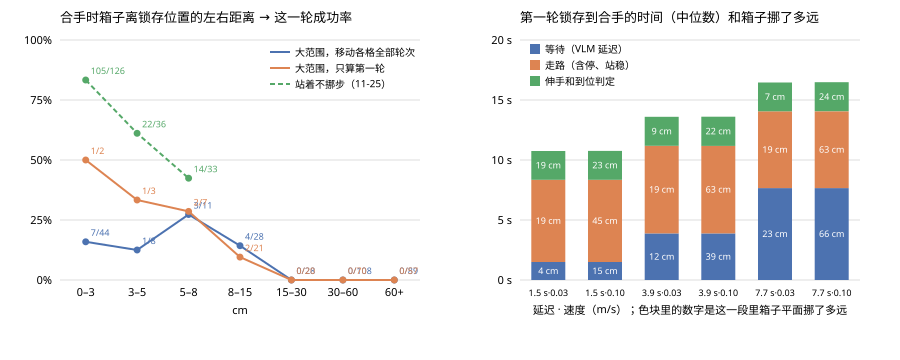

# 实验一续 · 机器人要走过去的大范围设定（2026-11-25）

接着 [站着不挪步的版本](stance-dynamic-20261125.md)：那一版箱子只能在 10 cm 内动，结论只对厘米级位移成立。这一版让机器人每一轮都从任务起点走过去，箱子摆在台面整段左右范围里，用来在大范围设定下重做问题 A，并给实验四的大范围版准备同一套场景。只做诊断，不改方法。

**结论：在“机器人要走过去”的设定下，问题 A 成立，而且很彻底——箱子只要在动（哪怕 0.03 m/s），阻塞式做法三档延迟下都基本做不成（0–5 / 30），而静止时是 21–27 / 30。** 失败几乎全是“走到了，但箱子已经不在够得着的地方”：第一轮合手时箱子离锁存位置多半已有几十厘米，超过 15 cm 的轮次一个都没成功（第一轮 0 / 147，全部轮次 0 / 225）。信息过时的主要来源是**走路**：只要走一次，从延迟结束到能伸手就要 6.3–7 s，比本地 Qwen（1.5 s）和 GPT（3.9 s）的延迟都长；只有 Gemini（7.7 s）这一档，等待和走路差不多长。按位移估的临界速度约 0.0016–0.0027 m/s（每秒两三毫米），比测过的最慢档 0.03 m/s 还低一个数量级。

| 延迟 | 静态 | 往复 0.03 m/s | 往复 0.10 m/s | 静态成功回合用时中位 |
|---|---|---|---|---|
| 1.5 s（75 步，本地 Qwen） | 27 / 30 | 5 / 30（-73.3） | 3 / 30（-80.0） | 14.1 s |
| 3.9 s（194 步，GPT-6.2 Astra） | 26 / 30 | 3 / 30（-76.7） | 1 / 30（-83.3） | 16.7 s |
| 7.7 s（383 步，Gemini 4 Argon） | 21 / 30 | 3 / 30（-60.0） | 0 / 30（-70.0） | 21.2 s |

（括号里是比同延迟静态低多少个百分点。时限 2500 步，所有格相同。）



## 第一步结果：走路接进抓取后，静态验收 27 / 30，过线

验收种子 8000–8029，短延迟、箱子静止，每个种子一个回合，只评一次（运行名 `exp1-wide-static-20261125-r1-s<种子>`；策略和仿真代码是提交 32e04e3，其中 3 个种子用只改了批量脚本的 94f7f8f 补跑，原因见“过程中的问题”）。

| 项目 | 数值 |
|---|---|
| 回合成功 | **27 / 30，过线**（门槛 26） |
| 第一轮成功 | 25 / 30 |
| 在旧时限 1450 步以内成功 | 25 / 30 |
| 终止原因 | 成功 27，到时限 3，跌倒 0 |
| 成功回合用时（从第一次锁存算起） | 中位 14.1 s，范围 13.1–41.5 s |
| 第一轮走路（延迟结束到站稳开始抬手） | 中位 6.85 s，范围 6.3–18.3 s |
| 尝试轮数 | 共 46 轮：成功 27，没碰到 11，碰到没夹住 5，碰倒 3 |

第一轮没成的 5 个，按事先写定的顺序归因：

| 种子 | 第一轮结果 | 离台面 | 箱子在机器人左侧 | 伸手后退 | 归因 | 回合结局 |
|---|---|---|---|---|---|---|
| 8011 | 碰倒 | 15.0 cm | -4.5 cm | 30 cm | 走路落点（停得太近） | 到时限 |
| 8026 | 碰到没夹住 | 16.3 cm | -2.7 cm | 22 cm | 走路落点（停得太近） | 到时限 |
| 8025 | 没碰到 | 18.5 cm | -10.5 cm（刚好压在窗口边上） | 25 cm | 走路落点（偏右） | 第二轮成功 |
| 8000 | 碰到没夹住 | 21.7 cm | +0.4 cm | 3 cm | 合手之后 | 第二轮成功 |
| 8005 | 合手前把箱子碰倒 | 17.9 cm | -4.5 cm | 0 cm | 其他：左手差 21 cm 没到位，伸手途中碰倒箱子 | 到时限 |

- **走路落点是主因，但不是单纯“走不准”**：三个归到落点的回合，同时都有 22–30 cm 的伸手后退。两个是停得比验证过的站位近（15、16 cm；站着不挪步时验证的是 17–27 cm），和 11-24 记录里“停得太近，抬手时被台沿顶回去”是同一个现象；8025 是箱子偏到右侧 10.5 cm 的边上。落点在窗口内的 22 个回合第一轮成功 20 个，窗口外的 8 个成功 5 个。
- **伸手后退**本身（落点正常时）这一批没有出现。
- **合手之后**只有 1 个，第二轮救回。
- 重试救回 2 个（8000、8025），都是第一轮没把箱子碰倒的。到时限的三个：8005、8011 第一轮就把箱子碰倒；8026 第一轮蹭到没夹住，之后两轮仍没成，第三轮碰倒。
- **两脚交叉**：36 次走路的“停”段里，参考交叉 1 次（8026 第二轮，交叉持续 17 个控制步），实测脚踝没有交叉，停段里骨盆挪了 34 cm，没有跌倒；这个回合本来第一轮已经失败，最后到时限。没有加过滤。

## 第二步结果：箱子在 1.7 m 线段上往复

八个新条件各 30 回合，种子 8000–8029，和静态验收配对（提交 94f7f8f，运行名 `exp1-wide-{move003,move010,long-*,xlong-*}-20261125-d1-s<种子>`），短延迟静态就是第一步的验收。240 个回合全部有结论，没有跌倒。

### 按计划原文的判定

| 延迟 | 静态 | 80% 线 | 0.03 m/s | 0.10 m/s | 第一轮成功（静态 / 0.03 / 0.10） | 1450 步以内成功（同左） |
|---|---|---|---|---|---|---|
| 1.5 s | 90.0% | 72.0% | 16.7%（-73.3） | 10.0%（-80.0） | 25 / 2 / 1 | 25 / 2 / 1 |
| 3.9 s | 86.7% | 69.3% | 10.0%（-76.7） | 3.3%（-83.3） | 25 / 1 / 1 | 25 / 1 / 1 |
| 7.7 s | 70.0% | 56.0% | 10.0%（-60.0） | 0.0%（-70.0） | 20 / 1 / 0 | 20 / 1 / 0 |

- **六个移动格都比同延迟静态低 25 个百分点以上**（低 60–83 个点），按计划查失败集中在哪：
  - 第一轮失败、走过去并开始伸手的 174 轮里，**163 轮是“走到了但箱子已经不在够得着的地方”**（合手或到位判定截止那一刻，箱子相对骨盆左右不在 -15 到 +5 cm，或深度不在 8–24 cm）。各格是 26/28、28/29、28/29、27/29、26/29、28/30（顺序：1.5 s 的 0.03、0.10，3.9 s 的 0.03、0.10，7.7 s 的 0.03、0.10）。
  - 第一轮标记：碰倒和没碰到为主（例如 1.5 s 0.03：碰倒 22、没碰到 4、碰到没夹住 2；7.7 s 0.03：没碰到 19、碰倒 7）；移动格的第一轮没有一个是“夹住后滑落”，也没有跌倒。
  - 第一轮之后救回来的只有 0–3 个（各格 3、2、2、0、2、0）。
  - 所以失败集中在“错过目标”，重试也救不回来：**问题 A 在三档延迟、两档速度下全部成立**。不是执行瓶颈（滑落、跌倒都不主导）。
- **降幅出现在哪一档速度**：最低的非零档 0.03 m/s 已经大幅下降，按计划“按实测结果报告”，临界速度在 0.03 m/s 以下，由位移曲线估（见下）。
- **是不是“只要箱子在动就必然失败”**：按事先的线（某延迟下两个非零档都不超过 6 / 30），三档延迟都是（5 和 3、3 和 1、3 和 0）。**是。**

### 位移对成功率

六个移动格的所有轮次和第一轮，按合手那一刻（没合手的取到位判定截止那一刻）箱子离锁存位置的左右距离分档：

| 左右位移 | 全部轮次：轮数 / 成功 | 第一轮：轮数 / 成功 | 站着不挪步（11-25，全部轮次） |
|---|---|---|---|
| 0–3 cm | 44 / 7 | 2 / 1 | 126 / 105（83%） |
| 3–5 cm | 8 / 1 | 3 / 1 | 36 / 22（61%） |
| 5–8 cm | 11 / 3 | 7 / 2 | 33 / 14（42%） |
| 8–15 cm | 28 / 4 | 21 / 2 | – |
| 15–30 cm | 28 / 0 | 20 / 0 | – |
| 30–60 cm | 108 / 0 | 70 / 0 | – |
| 60 cm 以上 | 89 / 0 | 57 / 0 | – |

- **曲线延伸到几十厘米后很简单：超过 15 cm，0 / 225 轮成功；8–15 cm 还有一成多。** 站立版的 3 cm、5–8 cm 两个点和这里的趋势一致。“全部轮次”里 0–3 cm 只有 16%，是因为混进了重试轮：箱子已经倒了或停在一边，位移接近 0 但抓不起来。
- **临界位移**：按事先的规则取第一轮成功率首次低于 50% 的那一档的下沿，是 **3 cm**（0–3 cm 1 / 2，3–5 cm 1 / 3，每档只有两三轮，单看这里不可靠；和站立版“超过约 3 cm 开始掉”一致）。**临界速度** = 3 cm ÷ 第一轮锁存到合手的中位时间（1.5 s：11.2 s；3.9 s：14.1 s；7.7 s：18.4 s）≈ **0.0027 / 0.0021 / 0.0016 m/s**。
- **逻辑回归**（180 个第一轮）：位移每多 1 cm，对数几率 -0.24，p = 0.028；再加上延迟档和速度档，似然比检验 p = 0.63。按事先的规则（位移本身要 p < 0.01），**不能写“延迟和速度只通过位移起作用”**：加进延迟和速度确实没有多解释什么，但 180 个第一轮只有 6 个成功、几乎全在 8 cm 以上，位移本身的检验力不够。

### 位移和“延迟乘速度”接近吗：0.03 m/s 大体接近，0.10 m/s 不接近

- 第一轮实测左右位移 ÷（速度 × 锁存到合手的时间）的中位数 0.64（四分位 0.29–1.00）；相关系数 0.03 m/s 是 0.48，0.10 m/s 是 0.18。
- 原因是折返：锁存到合手要 11–18 s，0.10 m/s 时箱子走了 1.1–1.8 m，在 1.71 m 的线段上 **90 个第一轮里 71 个折返过**；0.03 m/s 时 90 个里 21 个。所以“长线段上基本不折返”只对 0.03 m/s 成立。另外实测位移还包含手碰箱子推出去的那一点，没合手的轮次取的是到位判定截止时的位置。

### 信息有多旧由什么组成

第一轮从锁存到合手（中位数），拆成三段，和每段里箱子平面挪了多远：

| 条件 | 等待 | 走路（含停和站稳） | 伸手和到位判定 | 合计 | 箱子在三段里各挪了 |
|---|---|---|---|---|---|
| 1.5 s · 0.03 | 1.50 s | 6.85 s | 2.40 s | 10.8 s | 4 / 19 / 19 cm |
| 1.5 s · 0.10 | 1.50 s | 6.85 s | 2.41 s | 10.8 s | 15 / 45 / 23 cm |
| 3.9 s · 0.03 | 3.88 s | 7.30 s | 2.42 s | 13.6 s | 12 / 19 / 9 cm |
| 3.9 s · 0.10 | 3.88 s | 7.30 s | 2.43 s | 13.6 s | 39 / 63 / 22 cm |
| 7.7 s · 0.03 | 7.66 s | 6.40 s | 2.40 s | 16.5 s | 23 / 19 / 7 cm |
| 7.7 s · 0.10 | 7.66 s | 6.40 s | 2.42 s | 16.5 s | 66 / 63 / 24 cm |

（“伸手”那一段的挪动包括手碰到箱子之后推出去的部分。各条件的走路时间差别是随机波动：同样的种子、同样的走法。）

**按事先的规则：**

- **1.5 s（本地 Qwen）：成立。** 第一轮走路的中位时长 6.85 s 大于延迟，90 个第一轮里 90 个走路都比延迟长。决定信息新旧的主要是走路时间，不是 VLM 延迟。
- **3.9 s（GPT）：成立。** 走路 7.3 s 大于延迟，90 / 90。
- **7.7 s（Gemini）：不成立。** 走路 6.4 s 小于延迟，只有 42 / 90 走路比延迟长；这一档等待和走路差不多一样重。

换个说法：只要这一轮要从起点走过去，哪怕 VLM 一点延迟都没有，从看到箱子到合手也至少要 8.7 s（第一轮走路最短 6.3 s + 伸手 2.4 s）。在这个设定下，单靠把 VLM 换快解决不了问题 A。

### 重试有没有用（追不上，还是只是慢）

第一轮失败之后：

| 条件 | 第一轮失败 | 场景完好：回合数（救回） | 场景被破坏：回合数（救回） | 重试轮里空转的（箱子已倒或推到够不着的深处，什么都没做） | 第二轮比第一轮手离箱子更近 | 第二轮合手时手到箱子的中位距离 |
|---|---|---|---|---|---|---|
| 1.5 s · 0.03 | 28 | 1（1） | 27（2） | 178 / 207 | 7 / 8 | 26 cm |
| 1.5 s · 0.10 | 29 | 10（2） | 19（0） | 65 / 115 | 18 / 22 | 52 cm |
| 3.9 s · 0.03 | 29 | 6（1） | 23（1） | 42 / 85 | 17 / 20 | 26 cm |
| 3.9 s · 0.10 | 29 | 13（0） | 16（0） | 35 / 83 | 15 / 23 | 61 cm |
| 7.7 s · 0.03 | 29 | 17（2） | 12（0） | 8 / 49 | 13 / 22 | 49 cm |
| 7.7 s · 0.10 | 30 | 10（0） | 20（0） | 19 / 57 | 16 / 18 | 41 cm |
| 三档静态 | 5 / 5 / 10 | 1（1）/ 2（0）/ 3（0） | 4（1）/ 3（1）/ 7（1） | 10 / 16、0 / 9、2 / 18 | – | – |

- **追不上，不只是慢。** 第二轮从新的锁存位置出发，手确实比第一轮离箱子近（多数格七到九成），但合手时仍差 26–61 cm；有第三轮可比的四格里，第三轮的中位距离 0.03 m/s 两格是 31、26 cm（不再缩小），0.10 m/s 两格是 29、50 cm（比第二轮近，但仍远在 15 cm 以外）。原因和第一轮一样：每一轮都要再走一次，箱子没被碰到时还在动。
- “重试好多轮”的回合（例如 1.5 s 0.03 m/s 每回合 11 轮）几乎都是空转：第一轮把箱子碰倒（这一格 22 / 30），之后箱子不再可抓，机器人每轮只是锁存、等待、空转，直到时限。
- 静态格里重试救回过 1–2 个，移动格里第一轮之后合计救回 9 个（180 个回合里）。

### Gemini 延迟（7.7 s）静态那一格为什么只有 21 / 30（看过数据后加的）

- **不是时限截断。** 30 个回合的第一轮全部做完了（没有一个回合在第一轮没结束时就到时限），所以“照实跑”和“只算第一轮做完的回合”都是 21 / 30。
- 第一轮没成的 10 个：合手之后 5 个（3 个夹住后滑落、2 个合上没夹住），伸手后退 2 个（骨盆后退 23–26 cm，落点在窗口内），走路落点 2 个（其中 8025 离台面 11.6 cm），其他 1 个。之后救回 1 个。
- 和短延迟静态（27 / 30）比，Fisher 精确检验 p = 0.10，每格 30 次分不开；“合手之后滑落”多了 3 个，原因没有定位。箱子静止，等待更长按理不应该更难；把这 6 个回合差当成随机波动还是真效应，要更多回合才能说。

### 两脚交叉（第一步和第二步合计）

429 次走路的“停”段里，参考里两脚交叉 19 次，实测脚踝交叉 4 次（其中 3 次参考也交叉），没有跌倒。**全部出现在第二轮及以后的走路里**（离台面很近、只要挪一小段的修正走路），第一轮走路一次都没有。停段里骨盆平均挪 4.8 cm（95% 在 12 cm 以内）；交叉的那些挪了 0.5–51 cm，最大的是 `exp1-wide-xlong-move010-…-s8019` 第二轮。没有加过滤。

## 没做的

- **中途换目标**（两个物体相距 50 cm）：没做。第二步跑完时 GPU 0–3 已经排给另外两个会话；而且在“箱子一动就基本抓不到”的结果下，它不会改变对问题 A 的判断。
- 7.7 s 静态比短延迟静态低 6 个回合的原因没有定位（见上）。
- 位移曲线 3 cm 以内的第一轮只有 2 轮，临界位移 3 cm 主要靠站立版的数支撑。

## 过程中的问题

- **同卡第二路被拒。** 一个回合启动时显存瞬时冲到约 20 GB，同卡第二路启动器检查显存不够就拒绝；批量脚本原来把这当一次失败，三次就放弃，验收里 8007、8008、8024 因此被放弃，它们都没有开始回合（启动器在建运行目录之前就退出）。改了批量脚本（94f7f8f）：拒绝时等 60 s 再试，不算次数；这三个用 94f7f8f 补跑（策略和仿真代码和 32e04e3 相同）。8007 在 GPU 0 上因为保活进程占卡又被拒，改到 GPU 3 单独启动。`infra-failed/` 里留下的 `exp1-wide-static-20261125-r1-s8007-*` 目录没有逐步日志，仿真在启动阶段就退出了，没有跑过回合。
- **调试批次的日期标签写错**：`dbg-exp1w-static-20261126-d1-*` 实际是 11-25 跑的。
- 分析脚本第一次在批次中途运行时读到了启动器还没写完结论的回合，已改为只读写完的（bd7c377），不影响最终数字。

## 怎么复现

```bash
source agentic/env.local.sh
D=agentic/pilot_experiments/experiment1_blocking_grasp
# 调试（12 个调试种子）
python $D/run_grasp_suite.py --group wide --debug --tag <标签> --gpus 0 1 2 3 --per-gpu 2
# 第一步：静态验收（时限 2500 步来自配置）
python $D/run_grasp_suite.py --group wide --tag 20261125-r1 --gpus 0 1 2 3 --per-gpu 2
python $D/analyze_wide.py static 'exp1-wide-static-20261125-r1-*'
# 第二步：八个条件一个队列
python $D/run_grasp_suite.py --group wide --tag 20261125-d1 --gpus 0 1 2 3 --per-gpu 2 \
  --conditions 0.1:75 0.03:75 0:194 0.1:194 0.03:194 0:383 0.1:383 0.03:383
python $D/analyze_wide.py dynamic 'exp1-wide-*-20261125-[rd]1-s*'
python $D/analyze_wide.py plot 'exp1-wide-*-20261125-[rd]1-s*' --out wide.svg
```

单个回合：成功的约 10 分钟，到时限的约 30 分钟（走路每 1 s 要生成一段 5 s 的动作、扩散 100 步）。一张 5090 并排两个。记录里的图是按 `analyze_wide.py dynamic` 打出的数画的；`plot` 画的同一张图在备份的 `scratch/wide-20261125.svg`。

## 数据在哪

- 开发机 `KVLA_AGENTIC_RUNS` 下的运行目录。每个有 `grasp-result.json`、`layout.json`、`rounds.jsonl`、`grasp-steps.jsonl`、`execution.jsonl`、视频，以及每一轮走路的 `walk-r<轮>/`（`plans.jsonl`、`commands.jsonl`、每次规划的 `plan-*.npz`）。
- 备份：开发机持久盘 `/mnt/cfs/d5bvk6/personal/mingqianzhou/kvla-exp1-wide-range/`（`runs/` 是 270 个正式运行和 14 个调试运行，`scratch/` 是分析输出、批次日志和图，`backup-done.txt` 是核对结果）。

（下面是开跑前写定的东西。）

## 这一轮接了什么

- **走路换成官方式生成。** 抓取回合里“走到台前站位”这一段交给 `LocomotionPolicy(generator='native')`（`kimodo_vla/oracle/grasp_walk.py`），设置照搬实验二验证过的那一套：每 1 s 从实测位置重新规划一段 5 s 的动作，接续已发参考的最后 5 帧，路径瞄过目标（增益 2），不给文字，扩散 100 步，走到离站位 5 cm 内后生成一段“停”，停完站稳再伸手。伸手、合手、抬起没动。开关是 `run_oracle.py --native-walk`，默认关，默认仍是原来按段走的做法。
- **站位。** 站位规则不变，再往后退 5 cm（站着不挪步时验证过的那一档）；左右让箱子落在机器人右侧 5 cm，也就是站着不挪步时验证区域（-10 到 0 cm）的正中，这样走路左右偏 ±5 cm 仍在验证过的范围里。
- **箱子摆放。** `run_oracle.py --box-wide`：深度（箱子中心在台面近边后方）12–20 cm 均匀，世界 y 在任务自带的复位范围 -5.63 到 -3.92 m（1.71 m）里均匀，偏转 ±45°。这段范围两端在任何偏转下箱子都完整在台面上（台面 y 是 -6.237 到 -3.763）。机器人从任务起始位置 (-1.58, -5.00) 出发，每个种子都要走：前进约 0.6–0.7 m，横移 -0.6 到 +1.1 m。
- **种子。** 调试 1200–1211，验收 8000–8029，都没用过（1000–1011、3000–3029、6000–6029、7000–7099 已用）。
- **运行名。** 进度页的前缀加 `wide`：`exp1-wide-static`（短延迟静态，即验收）、`exp1-wide-move003`、`exp1-wide-move010`、`exp1-wide-long-*`、`exp1-wide-xlong-*`；调试是 `dbg-exp1w-*`。

## 调试种子上看到的

12 个调试种子（1200–1211，运行名 `dbg-exp1w-static-20261126-d1-*`，标签里的日期写错成了 26 日，实际是 25 日跑的；提交 85d2982，时限还是 1450 步），短延迟、箱子静止，**11 个成功，都是第一轮**。接上之后没有改任何参数。

- 走路能用：12 次第一轮走路都没超时。从延迟结束到站稳开始抬手（含“停”段和站稳），10 个种子用 5–6 次规划（1 s 一次）、6.3–7.3 s；1206 用了 8 次（9.3 s），1211 用了 11 次（12.3 s）。
- 进“停”段时离站位 2–5 cm，停完站稳后离站位 3–9 cm：“停”段本身还会挪几厘米（种子 1200 往前多走了约 6 cm，站稳后离台面只有 15 cm，仍然成功）。左右有偏向：瞄的是箱子在右侧 5 cm，站稳后实测箱子在 -4 到 +2 cm，多数比瞄的偏左 1–6 cm。
- 唯一失败的 1203：站稳后箱子在机器人左侧 3 cm（瞄的是右侧 5 cm，左右偏了 8 cm），伸手时骨盆后退 26 cm，手没到；第二轮走路用了 10.3 s（9 次规划），站到离台面 41 cm 处，到时限。和站着不挪步时“箱子偏左就容易后退”的现象一致。

另用两个调试种子（1200、1201）试了 Gemini 延迟、0.10 m/s 移动和 2500 步时限，确认移动箱子加走路的整条链能跑、Arena 接受更长的回合（运行名 `dbg-exp1w-xlong-move010-20261125-t1-*`）。

## 事先写定的判定和分析口径

在看验收数据之前写定并提交。

### 时限

**所有条件统一 2500 个控制步（50 s），原来是 1450 步（29 s）。** 依据调试种子上量到的走路耗时：从延迟结束到站稳开始抬手，第一轮多数 6.3–7.3 s（12 个调试种子里 10 个，含“停”段和站稳；另两个 9.3 和 12.3 s）；抬手到合手约 2.4 s；合手到判成功约 2.8 s；一轮失败还要加到位判定截止（最多 2.5 s）和松手收回（1.8 s）。按 1450 步，Gemini 延迟（7.7 s）下第一轮约在 21 s 才可能判成功，第二轮根本跑不完，阻塞式“失败后重试”这一条在长延迟下等于没有。定的规则是：**最长延迟下、走路按多数回合的耗时算，也要能完整跑完两轮**：1.9 s 站稳 + 2 ×（7.7 + 7.3 + 2.4 + 2.5 + 1.8）s + 2.8 s ≈ 48 s，取 2500 步。为了和以前的结果对得上，另报每个条件里“在 1450 步以内就成功”的回合数。

### 第一步：静态验收

- 30 个验收种子 8000–8029，短延迟 75 步，箱子静止，每个种子一个回合，只评一次。成功判据不变：箱子质心比初始静止高度高至少 10 cm，双手夹持，离开支撑面，连续 0.5 s。至少 26 个成功才进第二步。没过线就停，写失败归因，不调参重跑，不改区域。
- 第一轮失败的归因，按下面顺序取第一个成立的：
  1. **合手之后**：门控已触发、两手合上了，之后没成功（碰倒、没夹住、滑落）。
  2. **走路落点**：站稳后骨盆离台面近边不在 17–27 cm（站着不挪步时两档站位实测的整个范围），或箱子相对机器人的左右偏移不在 -10.5 到 +0.5 cm（验证区域 -10 到 0 cm，区域验收实测 -9.3 到 +0.1 cm）。
  3. **伸手后退**：抬手和前伸期间骨盆向后挪了 15 cm 以上。
  4. **其他**：以上都不是（例如手腕差几厘米、判定没触发）。
- 另报：落点在窗口内和窗口外各自的第一轮成功率；第一轮走路用时。
- **两脚交叉**：每次走路的“停”段里，参考的左脚踝跑到右脚踝右侧（朝向 +x 时左脚 y 小于右脚 y）记为一次参考交叉，实测脚踝同样判一次实际交叉；记次数、停段里骨盆滑了多远、有没有跌倒、那个回合的结果。不加过滤。

### 第二步：移动箱子（过线才做）

- **运动。** 箱子沿台面左右方向在 y = -5.63 到 -3.92 m 之间往复（1.71 m，就是摆放范围，两端在任何偏转下都完整受支撑），深度和偏转不变，到端点折返；种子决定起点和方向，和静态是同一组摆放。速度 0.03 和 0.10 m/s。首轮锁存时启动驱动，第一次检测到手与箱子接触时撤驱动，之后不清零速度、不锁定、重试时不恢复驱动（沿用站立版的实现，代码没改）。
- **阻塞式循环不变。** 每轮读一次箱子位姿并锁存，原地等固定延迟，然后走过去、伸手、合手、抬起，整段动作结束才刷新目标；失败后从当前状态开下一轮，直到成功、跌倒或时限。
- **条件。** 延迟 75 / 194 / 383 步（1.5 / 3.9 / 7.7 s）× 速度 0 / 0.03 / 0.10，每格 30 回合，种子 8000–8029 配对。短延迟静态直接用第一步的验收运行，不重跑。
- **判定（按计划原文，不改阈值，三档延迟分开）。** 移动档达到同延迟静态成功率的 80%：主要损失速度。比静态低 25 个百分点以上：查锁存误差、首次接触和滑落；失败集中在错过目标或来不及重试时，问题 A 在这一档成立；滑落或跌倒主导时单列为执行瓶颈。报告首次达到降幅的速度档及其相邻较慢档；最低非零档已下降、都没下降或不单调时按实测报告。
- **“是不是只要箱子在动就必然失败”。** 某延迟下两个非零速度档的成功率都不超过 20%（30 个里最多 6 个）算“这一延迟下动就必然失败”。临界位移取下面位移曲线里第一轮成功率首次低于 50% 的那一档的下沿；临界速度 = 临界位移 ÷ 该延迟下第一轮“锁存到合手”的中位时间。
- **主分析：按合手时箱子离锁存位置多远。** 每一轮取合手那一刻（没合手的取到位判定截止那一刻）箱子质心相对锁存位置的左右位移和平面位移，分档 0–3、3–5、5–8、8–15、15–30、30–60、60 cm 以上，报各档轮数、成功率和失败标记。六个移动条件的所有轮次合在一起，另把第一轮单独列出。逻辑回归（样本：六个移动条件的第一轮，180 轮）“成功 ~ 实测左右位移”对比“再加上延迟档和速度档”，加上之后似然比检验 p > 0.05 且位移本身 p < 0.01，就写“延迟和速度只通过位移起作用”。站立版的点（3 cm 内 83%，5–8 cm 42%）画在同一张图上。
- **位移和“延迟乘速度”是否接近。** 第一轮实测左右位移对“速度 × 锁存到合手时间”的相关系数和比值中位数；另报第一轮里有几轮在合手前折返过。
- **信息有多旧由什么组成。** 每一轮把“锁存到合手（或到位判定截止）”拆成三段：等待（锁存到延迟结束）、走路（延迟结束到站稳、开始抬手，含“停”段和站稳）、伸手和到位判定（开始抬手到合手）。每段的时长和这段里箱子平面挪了多远，按条件报中位数。**结论规则：** 第一轮走路段的中位时长大于某档延迟时，写“在这个设定下，这一档里决定信息新旧的主要是走路时间，不是 VLM 延迟”；小于时写不成立。三档分别写。
- **逐轮标记。** 沿用：没碰到、碰到没夹住、夹住后滑落、碰倒、成功、时限到时还夹着。另加一类 **“走到了但箱子已经不在够得着的地方”**：这一轮走完并开始伸手、没成功，而且在合手（或到位判定截止）那一刻，箱子中心相对机器人骨盆的左右偏移不在 -15 到 +5 cm，或深度不在 8–24 cm（验证区域每边放宽半个地图格）。它和原来的标记并列记，不替换。
- **重试和场景破坏。** 沿用站立版的口径：首轮失败、之后重试成功的回合数；相邻两轮锁存之间箱子平面位移超过 5 cm、或偏转变化超过 20°、或倒了（竖直轴偏离超过 30°）、或出了摆放范围，算“场景被破坏”（动态条件只算撤驱动之后）；场景完好和被破坏时的重试成功率分开报。
- **中途换目标**（两个物体相距 50 cm）排在最后，时间不够就写明没做。

### 看过部分第二步数据之后加的两项（2026-11-25 傍晚，总调度会话提出）

不属于事先口径，单独标明；时限和运行都不改。

- **Gemini 延迟（7.7 s）各格：时限是不是在第一轮做完之前就到了。** 只有一轮、没成功、也没走到松手收回的回合，算“第一轮没做完就到时限”，记下到时限那一刻处在哪个阶段（走路、站稳、伸手……）。7.7 s 这一行同时报两种数：照实跑出来的，和只算第一轮做完了的回合。
- **移动各格：重试有没有让手离箱子更近。** 每一轮在合手（或到位判定截止）那一刻，两只手腕中点到箱子中心的水平距离；和上一轮比是变近还是变远。用来分开“追不上”和“只是慢”。
