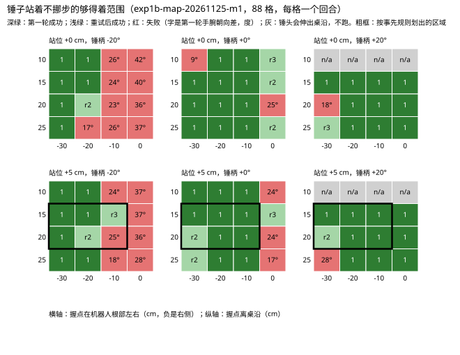
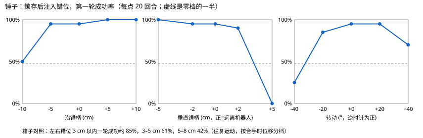

# 实验一（锤子）· DoubleDesk 右手抓锤子

**状态：三步都做完。** 静态区域内 30 / 30 过线；三条容错曲线、移动交叉检验和与抓箱子的逐条对比在后面。设定和判定规则都在看数据之前提交。

## 要回答什么

抓箱子（[实验一](../experiment1_blocking_grasp/README.md)、[续](../experiment1_blocking_grasp/stance-dynamic-20261125.md)）得到的失败机理全部来自同一种抓法：50 g 的纸箱，两只拳头左右对夹。锤子和它差别最大：单手、用手指握、物体小、有方向（只有锤柄能握）、重 350 g。这一组只做诊断，回答“抓箱子的结论哪些在锤子上也成立，哪些只是箱子的特性”。

## 设定

和抓箱子一样的地方：冻结 Kimodo 生成参考，冻结 SONIC 跟踪；机器人站着不挪步，根和脚用 IK 钉住，只动手；阻塞式一轮（读一次真值位姿并锁存 → 原地等 75 步 → 伸手 → 到位后合手 → 抬起 → 保持），失败从当前状态再来一轮，直到成功、跌倒或 1450 步时限；到位门控、成功判据、逐轮标记的定义都沿用。

不同的地方：

- **场景**：Arena 任务 `Isaac-Move-PickPlace-DoubleDesk-G129-Dex3-Wholebody`。锤子放在右边那张桌子上（桌面高 0.7455 m，x ∈ [-3.80, -1.33]，y ∈ [-3.69, -2.93]）。机器人放在桌前，面朝 -y（朝桌子），站稳后从头到尾不挪步。原任务机器人出生在 (-3.7, -2.2) 面朝 +x，要转身走过去；这里直接放到桌前。
- **锤子**：一个刚体，总长 32 cm，平躺在桌上（厚 2.7 cm）。锤柄沿锤子自身的 y 轴，长约 26 cm，截面 3.4 cm × 2.5 cm；锤头在 +y 端，宽 12 cm。质量 0.35 kg（任务配置覆盖了资产里的 0.665 kg），质心在几何中心偏锤头约 1 cm。原任务里锤柄大致和桌沿平行，锤头指向机器人的左边，偏转 ±20°。
- **只用右手**。左手保持锚定时的姿势，合手指令恒为“张开”。右手的合手指令是一个开合量：0 是 Arena 的张开姿势，1 是 Arena 固定的握拳姿势（拇指、中指、食指各自转到固定角度），中间按关节角线性插值；本实验取 0.6（见下面“调试”），手指碰到东西就停在那里。抓箱子用的是 1。
- **握在哪、从哪来**（由锤柄位姿决定，代码 `kimodo_vla/oracle/hammer_policy.py` 的 `grasp_pose`）：
  - 握点：锤柄轴线上、质心所在的那一点（锤子自身坐标 (0.002, 0.01, 0)），在锤柄靠锤头的一段，离锤头根部约 9 cm。手宽 8 cm，碰不到锤头。
  - 手的朝向：掌心朝下朝后，手指越过锤柄指向远离机器人的方向、向下倾 40°；手指弯曲的转轴沿锤柄（指向锤头）。所以合手时食指和中指从锤柄远侧往回勾，拇指从近侧往前压。
  - 握点放在手腕坐标里手指前方 15 cm、掌侧 3.5 cm 处（张开的手指和张开的拇指之间），整体再抬高 1 cm，让张开的指尖离桌面约 1 cm。
  - 路线：从身侧抬手到桌沿上方（0.8 s）→ 平移到握点正上方 8 cm（0.8 s）→ 竖直下降到握持位（0.8 s）→ 门控判定右腕到位并停稳 0.1 s 后合手 → 等 0.5 s → 竖直抬高 20 cm（1.5 s）→ 保持 1.2 s。到位门控的容差和箱子相同：位置 5 cm、角度 0.25 rad、腕速 0.1 m/s。手到位阶段同样用实测手腕修正指令（实测差距的 0.7 倍，上限 12 cm），合手后不再修正。
- **站位规则**：和箱子同一条规则，按握持时手腕的位置算：手腕在根部前方 0.25 m，但根部离桌沿不近于 0.19 m；再加一个“再退后”量（地图里取 0 和 5 cm）。
- **成功判据**（计划原文）：锤子质心比初始静止高度高至少 10 cm，同时右手压在锤子上、除机器人以外没有任何东西碰着锤子，连续 0.5 s。“手”的定义同箱子：腕部偏航连杆及以外（手掌、掌上相机座、手指）。Arena 原任务的奖励（锤子进篮子才给分，本实验恒为 0）另存在 `grasp-result.json` 的 `arena` 字段。
- **记录**：除了箱子已有的逐步记录，每步加记右手 7 个手指关节的位置和它们的目标值（`grasp-steps.jsonl` 的 `right_fingers`、`right_finger_target`）。

## 调试：Arena 的握拳会把锤柄挤出去

调试只用一个摆放（握点离桌沿 13 cm、机器人右侧 20 cm、锤柄不偏、站位再退 5 cm），每次只跑第一轮（`--steps 450`），运行名 `dbg-exp1b-*`。

- **到位不是问题。** 每次右腕都到了握持位 1.2–2.1 cm 以内、朝向差 2–3°，骨盆后退 2 cm 左右，门控照常触发。
- **合成整拳时锤子被挤飞。** Arena 的合手是把手指转到固定的握拳角度。张开的 Dex3 手拇指朝掌侧伸出 11 cm，掌心朝下时会戳进桌面，所以平躺的锤柄只能落在指尖和拇指尖之间；手指继续往拳的方向合，指尖从锤柄下半部把它往上楔，同时只有中指和拇指压着（食指先脱开），力在锤柄方向上错开 3 cm，锤子绕竖直轴转 65–170°，0.1–0.3 s 后从指间滑出。六种握法（握点在质心或柄尾、手腕前倾 40° 或 50°、握点在手里的位置 13–17 cm、整体抬高 1–4.5 cm）都是这样：锤子被带起 4–11 cm、离桌 0.04–0.16 s，然后翻倒、掉回桌面或掉到地上，接触力峰值 500–1300 N。
- **只合到一半多一点就握住了。** 同一摆放、同一握法，只改开合量：0.4 手指碰到锤柄但夹不住；0.5、0.6（两次，握持位高度 1 cm 和 2.2 cm）、0.65 都是第一轮成功，手指停在锤柄上，接触力稳定在约 100 N，锤子被抬高 18–19 cm，转动不超过 16°；0.75 握住约 0.5 s 后转着滑出；1（整拳）如上。取能握住的区间 0.5–0.65 的中点附近 0.6，之后不再改。
- 定下来的握法：握点在质心、手腕前倾 40°、握点在手里的位置（手指前方 15 cm、掌侧 3.5 cm）、整体抬高 1 cm、开合量 0.6。调参只看过这一个摆放，所以它在别的位置和朝向上行不行，要看地图。

## 第一步结果：地图和区域

地图批次 `exp1b-map-20261125-m1-*`，88 格各一个回合（前 3 格在提交 909a861 上跑，之后批量入口换成 83b04b9 / f3aec79：只改了排队方式和第二步的配置项，策略、仿真钩子、判据和握法参数都没变）。



| 项目 | 数值 |
|---|---|
| 回合成功 | 65 / 88，其中第一轮成功 54 |
| 伸手时骨盆后退 | 全部 ≤ 7 cm（箱子在深处时 22–49 cm） |
| 合上手的轮次手腕离握持位 | 全部 ≤ 4 cm |
| 失败的 23 个回合 | 22 个是第一轮手腕朝向差超过门控的 14°（17–42°），手一直没合上；1 个是合手后没握住 |

- **够不着的不是距离，是手腕的朝向。** 握点在机器人右侧 20–30 cm 时几乎处处能抓；越靠近身体中线、尤其锤头转离机器人（-20°）时，手腕要外旋得更多，朝向差到 23–42°，到位门控不触发。离桌沿 10–25 cm 之间深度几乎不起作用。
- **重试有时有用**：11 个回合是第二轮以后才成功（浅绿），多是第一轮手腕朝向差在 14° 附近、下一轮刚好进了门控。

按事先的规则划出的区域（`report_hammer.py --pick-region`）：**站位比规则再退 5 cm，握点离桌沿 15–20 cm、在机器人右侧 10–30 cm，锤柄偏转 ±20°**，框内 18 个回合成功 17 个。写进 `configs/hammer-grasp.json` 的 `stand.region`，之后不改。

### 验收：30 / 30，过线

代码提交 217a553，种子 8000–8029，锤子在区域内均匀随机摆放、锤柄偏转 ±20°，每个种子一个回合，只评一次（运行名 `exp1b-region-20261125-r1-s<种子>`）。

| 项目 | 数值 |
|---|---|
| 回合成功 | **30 / 30，过线**（门槛 26） |
| 第一轮成功 | 29 / 30 |
| 唯一的第一轮失败 | 8006：合上了手但没握住，第二轮成功 |
| 成功用时（从第一次锁存算起） | 中位 6.0 s，范围 5.9–16.5 s |
| 仿真器启动失败重跑 | 0 |

## 第二步结果：三条容错曲线

注入错位 240 回合（`exp1b-inj-*-20261125-s2-*`，提交 b967ac3），种子 8000–8019，每档 20 回合；零档是验收里同样 20 个种子（19 / 20 第一轮成功）。表里是第一轮成功数。



| 沿锤柄（cm，正是朝锤头） | -10 | -5 | 0 | +5 | +10 |
|---|---|---|---|---|---|
| 第一轮成功 | 10 | 19 | 19 | 20 | 20 |

| 垂直锤柄（cm，正是远离机器人） | -5 | -2 | 0 | +2 | +5 |
|---|---|---|---|---|---|
| 第一轮成功 | 20 | 19 | 19 | 18 | **0** |

| 绕握点转动（°，从上往下看逆时针为正） | -40 | -20 | 0 | +20 | +40 |
|---|---|---|---|---|---|
| 第一轮成功 | **5** | 17 | 19 | 19 | 14 |

| 容错（第一轮成功率降到零档一半的位置） | 负方向 | 正方向 | 箱子 |
|---|---|---|---|
| 沿锤柄 | 超过 10 cm | 超过 10 cm | 左右 3–5 cm（只有一个方向可测） |
| 垂直锤柄 | 超过 5 cm（朝机器人） | **3.4 cm**（远离机器人） | |
| 转动 | 32.5°（顺时针） | 超过 40° | |

- **沿锤柄几乎不怕错位**：手 8 cm 宽、锤柄 26 cm 长，挪 10 cm 手仍落在柄上。唯一掉下来的是 -10 cm（锤子往柄尾挪，手落到锤颈和锤头上），10 / 20。
- **垂直锤柄只怕一个方向**：手指从锤柄远侧往机器人方向勾，锤柄挪近了照样被勾进来（-5 cm 还是 20 / 20），挪远 5 cm 指尖就够不到远侧，0 / 20。这个方向的容错和箱子的 3–5 cm 同量级。
- **转动**：顺时针 40° 时手腕外旋不够（同地图里的朝向瓶颈），5 / 20；逆时针 40° 还有 14 / 20。

### 移动的锤子：按事先的规则没有落在曲线预测的位置

80 回合（`exp1b-move*-20261125-s2-*`）。锤子沿桌沿方向匀速平移（≈ 沿锤柄），碰到机器人就撤驱动。

| 条件 | 合手时锤子离锁存位置（中位） | 第一轮成功 | 回合成功 | 曲线预测（±1 标准差） |
|---|---|---|---|---|
| 0.03 m/s，等 75 步 | 11 cm | 17 | 18 | 12.0 ± 2.0 |
| 0.03 m/s，等 194 步 | 19 cm | 0 | 0 | 10.2 ± 1.9 |
| 0.10 m/s，等 75 步 | 40 cm | 0 | 0 | 9.7 ± 1.8 |
| 0.10 m/s，等 194 步 | 50 cm（走满 0.5 m 上限） | 0 | 0 | 9.6 ± 1.8 |

四个条件都不在预测的 ±2 个标准差内，按事先的口径写“没有落在曲线预测的位置”。原因是错位量超出了曲线测过的范围：沿锤柄只测到 ±10 cm，事先的规则把曲线在最大档之外按最大档延平（-10 cm 是 50%、+10 cm 是 100%），而实际上 19 cm 以上手已经落在锤柄之外，52 个回合第一轮根本没碰到锤子。唯一落在测过范围附近的条件（11 cm）比预测还好（17 / 20 对 12）。所以这组交叉检验说明的是“曲线的范围不够”，没有给出曲线在测过范围内不对的证据。和箱子不同，这里的移动是单向平移，没有往复周期的混叠，成败只由合手时挪了多远决定。

## 第三步：和抓箱子逐条对比

数据：地图、验收、注入错位、移动四组共 438 回合（`exp1b-*-20261125-*`），口径见下面“第二、三步的规则”，脚本 `analyze_hammer.py`。

### 重试

| | 第一轮失败 | 之后救回 |
|---|---|---|
| 锤子：静止的三组（地图、验收、注入） | 94 | 47（50%） |
| 锤子：移动的锤子 | 63 | 1（锤子已经出了够得着的范围） |
| 箱子：站着不动的九个条件 | 49 | 2 |
| 箱子：八个动态条件 | 45 | 0 |

- 按事先的“场景被破坏”定义，锤子 157 个第一轮失败里 133 个算“被破坏”，但其中多数只是因为锤子在划定区域之外（注入错位本身就把它放到了区域外）。只看物理上的扰动：**锤子一次也没有翻倒或掉下桌，最多被推开 9.4 cm（中位 1.4 cm）**；静止三组里物理上没被扰动的 68 个回合救回 26 个，被推开 5–9 cm 的 25 个救回 21 个（推动往往把锤柄推回手里）。箱子失败时一半以上直接倒了，或被碰飞 1–2 m。
- 地图里 11 个回合是重试后成功的，多是第一轮手腕朝向差在门控 14° 附近、下一轮进了门控。

### 失败类型

| | 失败轮次 | 物体侧占比 | 按事先的线 |
|---|---|---|---|
| 锤子：全部 | 452 | 19.7% | 不是主要问题 |
| 锤子：第一轮 | 157 | 46.5% | |
| 锤子：注入错位组的第一轮 | 59 | 95% | |
| 锤子：地图组 | 106 | 7.5%（几乎全是手腕朝向不够，手没合上） | |
| 箱子：全部 | 271 | 23.6% | 不是主要问题 |
| 箱子：区域验收和动态条件的第一轮 | 49 | 100% | |

标签：没碰到 269，碰到没握住 170，碰飞或碰掉 13，**握住后滑落 0**。和箱子一样：全体口径下物体侧不是主要问题，但只看手确实到了、物体却挪过的第一轮，失败几乎全在合手之后。

### 本体信号能不能提前分出握没握稳

合过手的 418 轮（成功 329，碰到没握住 79，碰飞 10），偶数种子拟合 222 轮、奇数种子检验 196 轮；“全猜握住”的准确率 83%。

| 时刻 | 只用手臂 | 只用手指 | 手臂 + 手指 | 最好的单个量（检验 AUC） |
|---|---|---|---|---|
| **合手后 0.2 s（主结果）** | 0.78 | 0.97 | **0.998**（准确率 98.5%） | 食指根关节位置 0.97 |
| 抬起中段 | 0.92 | 1.00 | 1.00 | 拇指第二关节 1.00 |
| 保持段末尾 | 1.00 | 1.00 | 1.00 | |

**按事先的线（≥ 0.9 可行），合手后 0.2 s 已经能分出来。** 原因很直接：手合到 0.6 的目标时，锤柄在手里，手指停在目标之前；手里没东西，手指就走到目标。手指和目标的差就是“手里有没有东西”的读数。只用手臂的 0.78 比箱子的 0.70 略好，仍不到线。箱子是两只拳头夹，拳头的关节角不带信息。

### 够得着的范围和骨盆后退

| | 箱子 | 锤子 |
|---|---|---|
| 区域 | 离桌沿 12–20 cm、左右 10 cm | 离桌沿 15–20 cm、右侧 10–30 cm（20 cm），锤柄 ±20° |
| 伸手时骨盆后退 | 深处 22–49 cm，是区域外失败的主因 | 地图 88 个第一轮全部 ≤ 7 cm（中位 2 cm），没有一次超过 15 cm |
| 限制区域的因素 | 距离：伸得远时骨盆后让、手腕够不到 | 手腕朝向：越靠近身体中线、锤柄越偏离（锤头转离机器人），右手要外旋得越多，差到 17–42° 门控不触发；深度 10–25 cm 几乎没有影响 |

锤子的握持位在手腕前方只有约 10 cm、高约 13 cm，手腕本身离根部不远（手腕伸出量规则下 0.25–0.30 m），所以不需要大幅前伸；箱子要两手张开夹住 21 cm 的箱子、手腕伸到箱子两侧，伸出量更大。

### 对比表

| 抓箱子的结论 | 锤子上 | 说明 |
|---|---|---|
| 站着不挪步、根和脚钉住、只动手时最可靠 | 同样成立 | 区域内 30 / 30（箱子 28 / 30） |
| 够得着的区域很窄 | 程度不同 | 锤子区域左右 20 cm、深 5 cm，也窄；但限制它的是手腕朝向，不是距离 |
| 伸手时骨盆后退 22–49 cm | 不成立 | 锤子全部 ≤ 7 cm；后退是箱子要伸得远造成的 |
| 成败由合手时物体离锁存位置多远决定，3–5 cm 开始掉 | 程度不同 | 仍由合手时的错位决定，但强烈依赖方向：沿锤柄超过 ±10 cm、转动约 ±30°、只有远离机器人那一侧 3.4 cm 就掉一半 |
| 延迟和速度只通过净位移起作用 | 同样成立（方式不同） | 单向平移时位移 = 速度 × 时间，11 cm 内 17 / 20，19 cm 起 0 / 20 |
| 所有成功都在第一轮，重试救不回来 | 不成立 | 静止时第一轮失败一半能救回；锤子不会被碰倒或碰飞，失败后多半还在手边。移动的锤子跑出够得着范围后同样救不回 |
| 失败后场景被破坏（箱子倒了、飞了） | 不成立 | 锤子从未翻倒或掉下桌，最多被推 9.4 cm |
| 合手后 0.2 s 本体信号分不出抓没抓稳（AUC 0.70） | 不成立（有手指时） | 加上手指关节检验 AUC 0.998；只用手臂 0.78，仍分不出 |
| 失败的物体侧占比：全体不是主要问题，第一轮在可达区内几乎全是物体侧 | 同样成立 | 全体 19.7%，注入组第一轮 95% |
| 整拳合手可用（箱子用拳头夹） | 不成立 | Arena 的整拳把锤柄挤飞，开合量只能在 0.5–0.65 之间 |

### 锤子暴露的、抓箱子时没出现的问题

1. **合手的“量”是一个新的失败维度。** Arena 只有张开和整拳两个姿势；整拳对细长的锤柄是灾难性的（挤飞、转着滑出），能握住的开合量窗口只有 0.5–0.65。箱子被两只拳头夹住，不存在这个问题。
2. **手腕朝向而不是距离限制了可达范围。** 抓箱子时手腕姿态固定（两掌相对），没碰到这一点；锤子要求手掌朝下、手指越过锤柄，右手在身体中线附近外旋不够。
3. **错位的方向性。** 箱子左右对称；锤子的容错沿锤柄、跨锤柄两侧、转动两侧都不一样，跨锤柄远离机器人的方向最敏感（和手指勾的方向有关）。“合手前再看一眼”只在这个方向上紧要。
4. **单手握持的接触力很大**（稳定握住时约 100 N，整拳时峰值 500–1300 N），抓箱子时没有记录到这么大的力。

## 第一步的规则（2026-11-25 提交，看地图数据之前）

### 地图

机器人站着不挪步，每格一个回合（每轮照常锁存、等 75 步、伸手、合手、抬起，失败重试到时限）。96 格，其中握点离桌沿 10 cm、锤头转向机器人 20° 的 8 格会让锤头伸出桌沿，不算摆放，不跑（`hammer_layout.placeable`，按锤柄和锤头两块矩形的实际轮廓判断），实跑 88 格：

- 握点离桌沿：10、15、20、25 cm
- 握点相对机器人根部的左右：-30、-20、-10、0 cm（负是机器人右侧）
- 锤柄偏转：-20°、0°、+20°（正是锤头转向机器人）
- 站位：规则站位，以及再往后 5 cm

### 划区域

沿用箱子的规则（`report_hammer.py --pick-region`）：每档站位，在“离桌沿 × 左右”的格子里找格子最多的矩形，矩形内三个偏转角的所有回合合起来成功率不低于 90%；并列时取成功率高的，再并列取左右更宽的，再并列取近的站位；矩形外沿每边往里收半格，只覆盖测过的格点之间。偏转角在区域里取 ±20° 均匀（原任务的范围）。

如果没有一个矩形达到 90%，第一步直接判为没过线，不再做 30 个种子的验收，转为瓶颈报告。

### 验收

30 个新种子（8000–8029），锤子在区域内均匀随机摆放、偏转 ±20°，每个种子一个回合，只评一次。至少 26 个成功算过线。

### 两天时限和瓶颈报告

到 2026-11-27 13:00（北京时间）还没过线就停下，不再调参。瓶颈按每个回合第一轮归类（用第一轮，因为后面的轮次起点已被打乱）：

| 类别 | 判据（按顺序取第一个符合的） |
|---|---|
| 够不着 | 到位门控超时，且右腕离目标超过 5 cm，且伸手时骨盆后退超过 15 cm 或差距主要在前后方向（前后分量超过总差距的 70%） |
| 到位精度 | 到位门控超时，且右腕离目标超过 5 cm（不属于上一类） |
| 手的朝向 | 到位门控超时，位置在 5 cm 内，但手腕朝向差超过 0.25 rad |
| 手指合拢没握住 | 合了手，但没有形成“只有右手托着、离开桌面”的握持（标记为没碰到、碰到没握住） |
| 握住后滑落 | 形成过握持，之后松脱 |
| 碰飞或碰掉 | 锤子被推开 10 cm 以上、翻过 30° 或掉下桌 |

调参只用调试运行（运行名以 `dbg-` 开头，摆放用 `--hammer-at` 指定），不用验收种子。

## 第二、三步的规则（2026-11-25 提交，看任何错位或移动数据之前；只有第一步过线才做）

脚本 `analyze_hammer.py`，各分析的定义都在里面。

### 注入错位

- 锁存之后一个控制步，把锤子瞬移一个已知量，速度清零，之后只有物理；其余（等待、伸手、合手、抬起）完全不变。三种错位：沿锤柄平移（正是朝锤头）、垂直锤柄的水平平移（正是远离机器人）、绕过握点的竖直轴转动（正是从上往下看逆时针）。只动第一轮；之后的轮次照常锁存当时的真值。
- 档位：沿锤柄 -10、-5、+5、+10 cm；垂直锤柄 -5、-2、+2、+5 cm；转动 -40°、-20°、+20°、+40°。零档就是区域验收里同一批种子的回合，不重跑。
- 种子：区域验收的前 20 个（8000–8019），每档 20 回合，种子配对。
- 主结果是第一轮成功率（不靠重试）。容错 = 从零档往某个方向走、第一轮成功率第一次降到零档一半的位置，在相邻两档之间线性插值，正负方向分开报；测到最大档还没降到一半就写“超过最大档”。

### 移动的锤子（交叉检验）

- 从第一次锁存开始，锤子沿桌沿方向匀速平移（方向由区域种子定，向机器人左或右），碰到机器人任何部位就撤掉驱动，之后只有物理；最多走 0.5 m。四个条件：0.03 和 0.10 m/s × 等待 75 和 194 步，每个条件同样 20 个种子。
- 预测：每个回合用实测的“锁存到合手（没合手的取到位判定截止）时锤子的错位”，沿锤柄分量查沿锤柄曲线，垂直分量和转角分别查另两条曲线（都除以各自的零档），三者相乘；曲线在档位之间线性插值，超出最大档按最大档。一个条件的预测成功数是各回合预测概率之和，标准差按独立伯努利算。实测落在预测 ±2 个标准差（标准差小于 0.5 时按 0.5）以内算“落在曲线预测的位置”。

### 和抓箱子对比的口径（沿用箱子的定义）

- 重试：首轮失败后重试救回了多少；场景是否被破坏 = 相邻两轮锁存之间锤子平面位移超过 5 cm、或偏转变化超过 20°、或翻过 30°、或掉下桌（比静止高度低 5 cm 以上）、或出了划定区域；注入错位的回合从注入后的位姿算起，移动的回合从撤驱动时算起。场景完好和被破坏分开统计。
- 失败类型：所有伸过手的失败轮次按标记分（没碰到、碰到没握住、握住后滑落、碰飞或碰掉）；再按箱子的分法分成身体侧（手没合上：没碰到、只蹭到、合手前碰倒）和物体侧（合手之后：没握住、滑落、碰倒），物体侧占 ≥ 50% 写“需要预测物体反应”，≤ 25% 写“不是主要问题”，中间写“部分需要”。第一轮和后面的轮次另外分开报。
- 本体信号：时刻（合手后 0.2 s、抬起中段、保持末尾）、标签、偶数种子拟合奇数种子检验、逻辑回归，都同箱子。输入在箱子的右臂量（关节跟踪残差、关节速度、腕速）之外，加右手 7 个手指关节的位置和“位置减目标”。分别报只用手臂、只用手指、两者合起来的检验 AUC；判定看两者合起来：≥ 0.9 可行，≤ 0.7 不可行，中间不确定。
- 够得着的范围：地图里每格第一轮的骨盆离桌沿、伸手时骨盆后退、手腕差距，按离桌沿、左右、站位分组，和箱子的地图并排。

## 怎么跑

```bash
source agentic/env.local.sh
D=agentic/pilot_experiments/experiment1b_hammer_grasp
# 单个调试回合：握点离桌沿 13 cm、右侧 20 cm、锤柄不偏、站位再退 5 cm
python agentic/scripts/run_oracle.py --run-id dbg-exp1b-x --task doubledesk --grasp-loop --stand-still \
  --hammer-at 0.13 -0.2 0 0.05 --sim-gpu 1 --policy-gpu 1 --share-policy-sim-gpu --gpu-min-free-mib 16384 --start-timeout-s 420
SEED='--sim-cache-seed /你的路径/doubledesk-sim-cache'   # 一次成功启动留下的 runtime/cache
# 地图、划区、验收（一张卡两路时把卡号写两遍）
python $D/run_hammer_suite.py --group map --tag 20261125-m1 --gpus 7 7 6 --wait-free $SEED
python $D/report_hammer.py 'exp1b-map-20261125-m1-*' --map --svg map.svg
python $D/report_hammer.py 'exp1b-map-20261125-m1-*' --pick-region
python $D/run_hammer_suite.py --group region --tag 20261125-r1 --gpus 7 7 6 --wait-free $SEED
# 第二步：注入错位，然后移动的锤子
python $D/run_hammer_suite.py --group inject --tag 20261125-s2 --gpus 7 7 6 2 2 3 3 --wait-free $SEED
python $D/run_hammer_suite.py --group motion --tag 20261125-s2 --gpus 7 7 6 2 2 3 3 --wait-free $SEED
python $D/analyze_hammer.py tolerance 20261125-s2 20261125-r1
python $D/analyze_hammer.py motion 20261125-s2 20261125-s2 20261125-r1
# 第三步
for a in retry failures proprio; do python $D/analyze_hammer.py $a 'exp1b-*-20261125-*'; done
python $D/analyze_hammer.py reach 'exp1b-map-20261125-m1-*'
```

批量入口把不认识的参数原样传给启动器，正式批次都加 `--sim-cache-seed <种子目录>`。

DoubleDesk 启动时主线程会卡在材质同步（`play()` 里），这时每个运行都在从零生成约 0.5 GB 的纹理缓存。两个开关：`--sim-cache-seed DIR` 在开仿真前把一次成功启动留下的 `runtime/cache` 拷进新运行（启动从 4 分钟以上降到约 1.5 分钟；之后 438 个正式回合里仍有 4 次启动失败，都自动重跑了）；`--start-timeout-s` 让启动器在仿真 420 s 还没开始站稳时杀掉它，批量入口会把这样的运行挪到 `infra-failed/` 后重跑。

单个回合约 4–12 分钟（成功即停），约 11 GB 显存。

## 数据在哪

- 开发机 `KVLA_AGENTIC_RUNS` 下的运行目录：地图 `exp1b-map-20261125-m1-*`（88）、验收 `exp1b-region-20261125-r1-*`（30）、注入错位 `exp1b-inj-*-20261125-s2-*`（240）、移动 `exp1b-move*-20261125-s2-*`（80）、调试 `dbg-exp1b-*`。每个有 `grasp-result.json`（每轮标记和 `notes`：骨盆离桌沿、后退、手腕差距和朝向差、合手时锤子的沿柄 / 跨柄 / 转角错位、注入和撤驱动记录）、`layout.json`、`grasp-steps.jsonl`（含右手手指关节和目标）、`execution.jsonl`、`rounds.jsonl`、头部相机视频。
- 备份：开发机持久盘 `/mnt/cfs/d5bvk6/personal/mingqianzhou/kvla-exp1b-hammer/`（`runs/` 和 `scratch/` 分析输出，`backup-log.txt` 是核对记录）。

## 没做的和已知问题

- 移动的锤子只做了沿桌沿（≈ 沿锤柄）一个方向，错位量大多超出曲线测过的范围；要真正检验曲线，需要错位落在 ±10 cm 内的条件（更慢的速度或更短的延迟），或把沿锤柄的曲线测到 ±20 cm。
- 开合量 0.6 只在一个调试摆放上定，区域内 30 / 30 说明它在区域里可用；区域外（尤其锤头转离机器人时）的失败主要是手腕朝向，和开合量无关。
- 握法只试了“从上方、掌心朝下”一种。张开的 Dex3 拇指朝掌侧伸出 11 cm，平躺的锤柄只能落在指尖和拇指尖之间，这是本实验所有结论的前提。
- “场景被破坏”按事先口径包含“出了划定区域”，注入错位本身就把锤子放到区域外，所以这一项对锤子偏大；正文另报了只看物理扰动的结果。
- 失败类型分析里“手在空中合上、没碰到锤子”起初被算成物体侧，和箱子的定义不一致，看结果前改正（提交 46106df）。
- 头部相机视频看不到全身。
