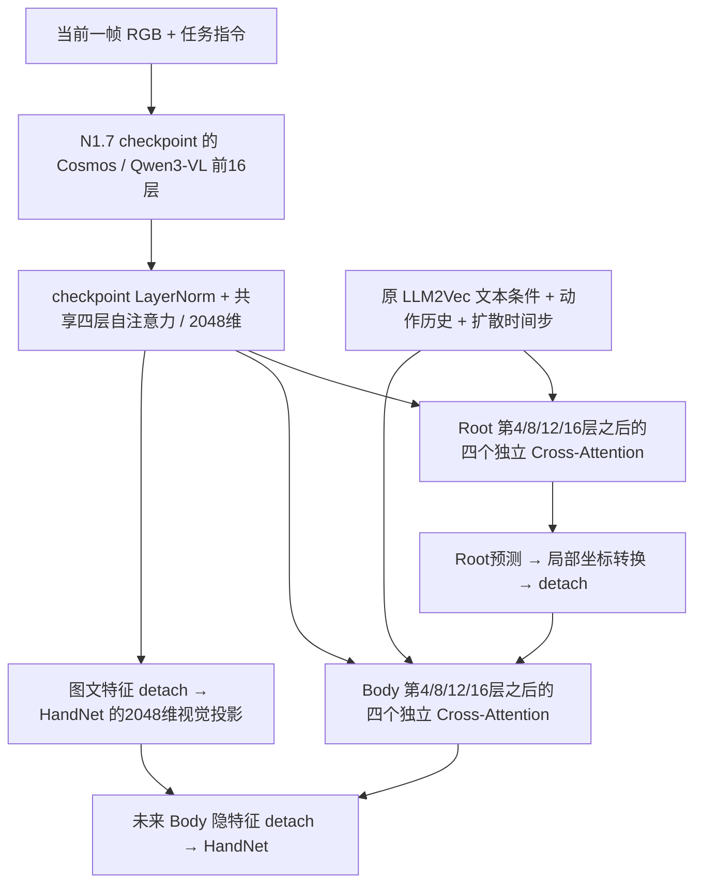

# DoubleDesk：GR00T N1.7 图文条件替换实验

本实验在 `model_improvement_lct1` 上保留 Kimodo-G1-RP-v1 的 Root/Body 运动先验，
用 N1.7 图文条件和八个新交叉注意力残差模块替换 DINOv3 与整条视觉 ControlNet。
没有加载 Kimodo-Policy 的 419h 策略预训练权重。正式训练与评估均已完成：20万步 checkpoint 在60回合中成功30次，成功率 **50%**。
论文参考值为40%，本次高10个百分点；本机同配方原模型对照尚缺，不能视为配对改进结论。

## 核对的资料和版本

| 资料 | 本次使用的版本/位置 |
| --- | --- |
| [GR00T 官方仓库](https://github.com/NVIDIA/Isaac-GR00T) | `/root/workspace/Isaac-GR00T-N1.7`，commit `c56f54128d92f743889b7e4cecfc1ceafd88739e` |
| [N1.7 checkpoint](https://huggingface.co/nvidia/GR00T-N1.7-3B) | revision `2fc962b973bccdd5d8ce4f67cc63b264d6886495` |
| [Cosmos VLM](https://huggingface.co/nvidia/Cosmos-Reason2-2B) | revision `9ce19a195e423419c349abfc86fd07178b230561`，已获授权下载 |
| Kimodo-Policy 论文 | `/root/workspace/kimodo-policy-paper/main_arxiv.pdf` 和同目录文本；重点为 §4、§5.2、§6.1、§6.6 |
| Kimodo-Policy 本地参考实现 | `/root/workspace/kimodo-policy`，commit `77cae02b476c2624af009b2e242dafab2b73ca29` |
| 本仓库改进前基线 | commit `8793328148be7589ec2b8c998f712d29aaa97cbf` |
| 原评测环境 | `/root/workspace/HumanoidArena`，commit `68479287a784a69be9ce6ad739311d2f11f75ef9` |

用户给出的 `https://github.com/kimodo-policy/kimodo-policy` 在本次访问时返回 404；本地参考仓库
README 另指向 `Yunheng-Wang/kimodo-policy`，该地址也返回 404。因此模型及实验设置以本地论文、
现有代码、原训练 YAML、原评测脚本和已保存的 `run_config.txt` 逐项交叉核对，没有假设已在线读取到该仓库。

**必须以 checkpoint 为准的差异：** 官方 N1.7 源码配置默认 `select_layer=12`，
本次发布权重的 `config.json` 实际为 **16**；VLM 宽度 **2048**，
`vl_self_attention_cfg` 为 **4 层、32 heads × 64 head_dim、dropout 0.2**。
发布权重里的 GR00T 动作头层数也不同于源码默认，本实验完全不构建或加载该动作头。

## 数据路径与模块



`groot_conditioning.py` 直接导入官方 `Qwen3Backbone` 与 `SelfAttentionTransformer` 源码。
VLM 的全部保留参数、`action_head.vlln.*`、`action_head.vl_self_attention.*` 均从 **N1.7**
权重严格加载。Cosmos 基础模型用于构建官方接口，随后所有保留的 VLM 参数都被 N1.7 策略权重覆盖；
并非只加载原始 Cosmos。加载报告为 VLM 494 个 tensor、LayerNorm 2 个、四层适配器 64 个。

Kimodo 原环境的 Transformers 5.1.0 去掉了 GR00T 面向 4.57.3 使用的 `language_model`、
`visual` 顶层别名。本实现只在局部子类中恢复只读属性，仍指向 `model.language_model` 与 `model.visual`；
没有重复注册模块、改 checkpoint 键名或修改 HF forward。完整真实前向和严格权重加载已验证兼容。

图像采用 N1.7 官方确定性 resize → center crop → resize，再交给 Cosmos processor；
保留原 Arena 不增加随机图像增强的训练设置。指令采用官方的小写和去标点规则，
image + text 的 user chat template 不附加 generation prompt。输入是一帧，保留全部有效图像及文本 token。
真实 doubledesk 四样本检查得到 `[4,109,2048]`；长度不是固定 109。

官方四层自注意力没有 padding mask 参数，故先按有效长度分组、移除 padding，
再执行原适配器并右侧补齐；新交叉注意力与 HandNet 都显式屏蔽补齐 token。
这里没有池化或把图文条件压缩到 50 帧。

八个注入模块在代码中使用零起始索引 `(3,7,11,15)`，即执行完第 4/8/12/16 个主干层后调用。
每个模块只取动作序列末尾未来 50 个 token，Query 为 `[B,50,1024]`，Key/Value 为共享的
`[B,L,2048]`；交叉注意力内部学习 Key/Value 的 2048→1024 投影。结果经过单独的零初始化
1024→1024 输出投影再残差相加。Root/Body 各四个模块参数独立，每个位置读取同一个条件对象。
没有复制 Kimodo Transformer 构建视觉分支，没有原 ControlNet 的 timestep/image-token MLP、
视觉到时间轴的 MLP、Root 控制分支到 Body 控制分支连接。

继续沿用原主干的文本 token、扩散 schedule、DDIM、历史掩码、417D 运动表示、Root 局部坐标转换、
预测未来动作的监督，以及全部手部损失。Root 局部预测在条件化 Body 前 detach；HandNet 的未来
Body 与图文输入也 detach。HandNet 修改视觉投影为 2048 维并支持可变 token/mask，其余结构不变。
由于 scratch 不加载 419h HandNet，HandNet 核心也是随机初始化，必须与新视觉投影一起训练。

## 单任务训练配方

主配置：`configs/arena_doubledesk_groot.yaml`；匹配的原 ControlNet scratch 配置：
`configs/arena_doubledesk_baseline.yaml`。

| 项目 | 设置 |
| --- | --- |
| 数据 | `HumanoidArena-data/HOI_double_desk/sonic_refpose_v3_1`，100 episodes / 56,712 windows |
| loader | 直接复用本地旧仓库 `MultiSourceG1Dataset`，`episode_uniform` |
| 监督来源 | 操作者 `action`；64D 实际状态提供历史；原取帧、坐标及动作 canonicalization |
| 运动序列 | 30Hz，100 历史 + 50 未来，417D |
| 全局 batch / 总步数 | 64 / 200,000 |
| 新注入模块、HandNet LR | 1e-4 / 1e-4 |
| 四层适配器及 LayerNorm LR | 解冻后 3e-5 |
| optimizer / scheduler | AdamW，weight decay .01；2,000 步 warmup，cosine，最小 LR 比例 .1 |
| 损失 | 原 MSE，Root/Body/Hand/Hand transition 权重 4/1/1/.2 |
| stage 1 | `[0,10000)`：冻结 Kimodo、VLM、LayerNorm/四层适配器，训练八个注入模块与 scratch HandNet |
| stage 2 | `[10000,200000)`：再解冻共享 LayerNorm/四层适配器，联合训练 |
| stage 3 | 默认关闭；确有必要时设置 `training.stages.vision_start`，只进一步解冻视觉编码器，LR 1e-6 |
| policy initialization | 禁止 `--init-checkpoint` / `initialization`；预训练运动先验和 N1.7 特征权重仍加载 |

按用户要求使用 GPU **4、5、6、7 四卡 DDP**；每卡 micro-batch 16、累积 1，保持全局 batch 64。
GPU 0–3 的其他训练和 GPU 4/6 的既有驻留服务保留。GPU 5 的 xiancun 由 Supervisor 管理，
持续检测外部负载，训练时自动让出，空闲后自动恢复；pipeline 在启动、训练结束和最终退出
（包括失败）时检查其服务并执行幂等 `ensure`，不停止监测器。分阶段解冻是本实验新增变量。
在解冻边界重建 DDP/优化器参数组，同时保留已训练参数的 Adam moments 和全局学习率进度。
checkpoint 包含新增模块、HandNet、**冻结状态下的适配器也始终保存**；可选视觉微调权重也会保存。
本实验不启用 EMA。

## 验证与入口

独立 `.venv-groot` 继承原 Kimodo 的 torch 环境，把新增依赖装在本仓库内；没有修改其他正在运行的训练环境。

```bash
cd /root/workspace/kimodo-policy-vlm-version-model_improvement_lct1
.venv-groot/bin/python scripts/download_groot.py
CUDA_VISIBLE_DEVICES=4 NO_ALBUMENTATIONS_UPDATE=1 HF_HUB_OFFLINE=1 \
  .venv-groot/bin/python scripts/check_groot.py --report outputs/groot_preflight_multigpu.json
```

真实检查报告 `outputs/groot_preflight_multigpu.json` 必须 `passed=true` 且实验配置指纹一致，训练入口才放行。
`--backbone-only` 使用真实 Kimodo/数据与合成图文 token，只做局部检查，**绝不产生通过的训练凭据**。

已完成的真实检查包括：零残差与原 T2M 输出完全一致、激活投影后 Root→Body 梯度隔离、
stage 1 冻结、stage 2 适配器收到非零梯度、HandNet 梯度隔离、完整 checkpoint 恢复、
10 步 DDIM/50 帧输出且一次规划仅调用一次 VLM。32 样本、包含第二阶段 Adam 更新的检查
峰值显存约 12.24 GiB；改用每卡 16 样本重新完整检查，峰值约 9.97 GiB。
单元测试另检查八模块独立性、具体注入层顺序及未来 50 帧 Query、图文 padding 隔离、
零输出投影的梯度启动、HandNet 可变 token，以及解冻时 Adam/LR 状态连续。

扩展旧仓库等价测试发现两项 `test_simple_matches_original` 的 36D SIMPLE 控制输出检查失败；
在 `/tmp/kimodo-vlm-baseline-check` 的修改前 HEAD 上得到相同失败（最大差异 1.0）。
Arena 和 40D 规划链路对比通过；不将已有 SIMPLE 问题混入本次模型改进。

四卡迁移后的当前 worktree 回归为 55 项通过、3 项跳过（单独排除上述 SIMPLE 文件）；
真实仿真预检 `outputs/groot_sim_smoke_v2/validation.json` 记录两次成功 `/infer`。
预检还修复了仿真 task ID 到缓存自然语言指令的映射，保证 VLM 与训练时读取同一条任务指令。
评估入口会检查 server 日志；即使仿真进程在 HTTP 500 后仍返回退出码 0，检查也会拒绝该结果。

通过预检后启动训练及自动正式评估：

```bash
.venv-groot/bin/python scripts/run_groot_experiment.py --gpus 4,5,6,7 --gpu 7 \
  --keepalive /root/workspace/xiancun/xiancun --detach
```

进程状态与失败原因记录在 `outputs/groot_<run-name>_status.json`，
训练记录在 `<run>/train.log`、`metrics.jsonl`；最终汇总在 `<run>/experiment_summary.json`。

## 成功率评估

使用 **同一** `/root/workspace/HumanoidArena` 仿真、SONIC ONNX、doubledesk test YAML 与
`eval_vla_suite.py`。仅 server 换成能加载新模型的本仓库入口，`OriginalTimingPlanner` 保留
原来的取帧时序；动作布局、根位移边界、SONIC 跟踪和成功判定均复用既有实现。

固定 fp32、10 次去噪、50 帧预测/30Hz、执行 15 模型帧、50Hz 控制、RTC 关闭；
种子 0/1/2，每种子 20 回合，每回合最多 2000 控制步，`persistent_sim=0`。
评估 manifest 保存环境 YAML、evaluator、SONIC encoder/decoder 的 SHA256。

```bash
.venv-groot/bin/python scripts/eval_arena_doubledesk.py \
  --checkpoint <run>/checkpoint_200000 --out outputs/doubledesk_groot_formal --gpu 7
```

同一个命令也可以评原 ControlNet checkpoint。`--smoke` 只执行一个 30-step 短回合，
用来检查仿真/服务接口，不作成功率统计。不能把预检的一个优化步或 smoke timeout 当成任务效果。

论文单任务 scratch DoubleDesk 为 **40.0±0.0%**。本地已有的 500k 多任务 scratch 评估是另一种
训练设置（本地 22/60=36.7%），不能标成同配方单任务基线。若需要严格的本机单任务对照，
用上面的 matched baseline 配置训练 200k 并用相同评估命令重测；论文 40% 始终只是引用参考值。

## 四卡迁移与恢复检查

主目录因并行工作已切到 `kimodo-vla-lct`，本实验改在独立 worktree
`/root/workspace/kimodo-policy-vlm-version-model_improvement_lct1` 上继续，分支仍为
`model_improvement_lct1`。数据、checkpoint、输出、日志与隔离环境用符号链接复用；
不会把另一分支的实现加载进正式训练。

旧单卡 run `scratch_20261031_171606` 在 2250 步停止，当时尚未到 10000 步首个保存点，
不能导出内存状态。其日志和迁移记录保留，四卡正式 run 从 scratch 重启，不加载检查用权重。
新配置在 100、1000 步及每 5000 步保存，增加 `--stop-after` 和
`touch <run>/CHECKPOINT_AND_STOP`：所有 rank 在完整更新后保存并退出；
删除请求文件后用 `torchrun ... scripts/train.py --resume <run>` 恢复。
随机状态逐 rank 收集保存；更改 GPU 数量时使用对应 rank 的新种子，不承诺轨迹逐位一致。
提前停止会阻止 pipeline 误启动最终评估。

四卡真实数据检查使用生产 batch 16 × 4，将解冻边界临时提前到第 3 步，
依次验证训练到第 6 步、恢复后保存停止到第 7 步、再次恢复到第 10 步。
`--audit-distributed` 对所有需保存的模型张量计算 SHA256 并跨 rank 比较，
每次退出必须四卡逐字节一致。检查报告为 `outputs/groot_ddp_preflight.json`，
每次参数哈希记录在 `log/arena_doubledesk_groot/ddp4_validation_20261101/`。
正式 launcher 强制检查其配置指纹和 GPU 列表。

## 本次运行（已完成）

- Run：`log/arena_doubledesk_groot/scratch_ddp4_20261101`，GPU 4/5/6/7。
- 状态：`outputs/groot_scratch_ddp4_20261101_status.json`，包含进程、命令、预检与保活状态。
- 日志：`outputs/groot_scratch_ddp4_20261101_pipeline.log` 与 `<run>/metrics.jsonl`。
- 四卡 pipeline PID `1432800`。已保存 `checkpoint_100` 和 `resume.pt`，包含冻结适配器、
  新注入模块、HandNet、优化器及四个 rank 的随机状态。启动验证记录为
  `outputs/groot_scratch_ddp4_20261101_launch_validation.json`。
- 热身后 stage 1 约 0.34–0.38 s/step；旧单卡约 1.07 s/step，约 2.8–3.1 倍。
  适配器解冻后吞吐量需另行观察，不能据此精确推算总训练时长。
- xiancun 在 02:02:18（服务器 UTC+8 日志）自动释放 GPU 5，监控 PID 23991 持续运行。
- 四卡训练已完成20万步，耗时23.14小时；正式评估耗时1.75小时，成功 **30/60=50%**。
  三个评估组为45%、45%、60%；失败为15次跌倒、15次超时。
- 详细报告：[RESULT_ANALYSIS.md](../experiments/doubledesk_groot_n17_20261101/RESULT_ANALYSIS.md)。
  统计区间约37.7%–62.3%，当前证据尚不足以确认稳定优于论文40%参考值。
- 曲线监控在流程完成后正常退出，最终图表和状态保留；xiancun已恢复实际计算。

## 实时曲线与训练监督

本次已启动独立 CPU 监控，每 60 秒读取真实训练记录并更新图表和健康检查。
后台监控不依赖终端连接，持续到训练与评估流程完成或报告终止状态。

```bash
.venv-groot/bin/python scripts/monitor_groot_training.py \
  --run-dir log/arena_doubledesk_groot/scratch_ddp4_20261101 \
  --status outputs/groot_scratch_ddp4_20261101_status.json --interval 60 --detach
```

产物在 `<run>/monitor/`：

- `dashboard.html`：自动刷新面板，含进度、近期损失、剩余训练时间、保存点、保活和告警。
- `training_curves.png`、`training_curves.pdf`：八幅曲线，包括各项损失、梯度、学习率、
  步耗时、rank-0 显存分配峰值及数据等待时间；标出适配器解冻边界。
- `metrics.csv`：全部原始指标导出；PNG 显示均匀采样原始点和完整记录上计算的100条记录滑动平均，约1000步。
- `health.json`、`alerts.jsonl`、`monitor.log`：当前健康状态、告警触发／解除事件和持续心跳。
- `snapshots/`：每小时及流程结束时保存 PNG 和对应状态 JSON。

告警检查 NaN/Inf、训练期5分钟无指标更新、主进程异常退出、同阶段持续损失／梯度突增、
xiancun 进程消失或状态过期。持续突增比较最近100条与此前500条中位数，损失阈值4倍、梯度5倍；
跨解冻边界不混合比较。图文适配器 LR 由配置与实际记录的注入模块 LR 按共享 scheduler 比例推导，
图中明确标记 derived。当前没有验证集损失，闭环任务效果仍由正式仿真成功率判断。

严重短时尖峰也单独检查：最近100条记录的损失最大值超过此前500条中位数20倍，
或裁剪前梯度超过100且超过此前中位数100倍时告警。`historical_spikes.json` 保留已经恢复的
历史尖峰（以此前100条同阶段记录为参考）。曲线采样额外保留每项指标最大的10个极值，避免漏掉
罕见的大尖峰；本次历史上约41460和62330步附近的尖峰已记录，目前已恢复。

## GitHub 归档

本次结果、完整指标CSV、最终曲线、分时快照及预检记录已归档到
[docs/experiments/doubledesk_groot_n17_20261101](../experiments/doubledesk_groot_n17_20261101/README.md)。
最终模型权重及原始运行日志保留在本地run目录。

提交前带 `KIMODO_ORIGINAL_REPO` 的最终回归为67项通过、1项BiGym依赖缺失跳过，
两项修改前已复现的SIMPLE等价问题单独排除；完整命令与日志见归档目录 `validation/`。
