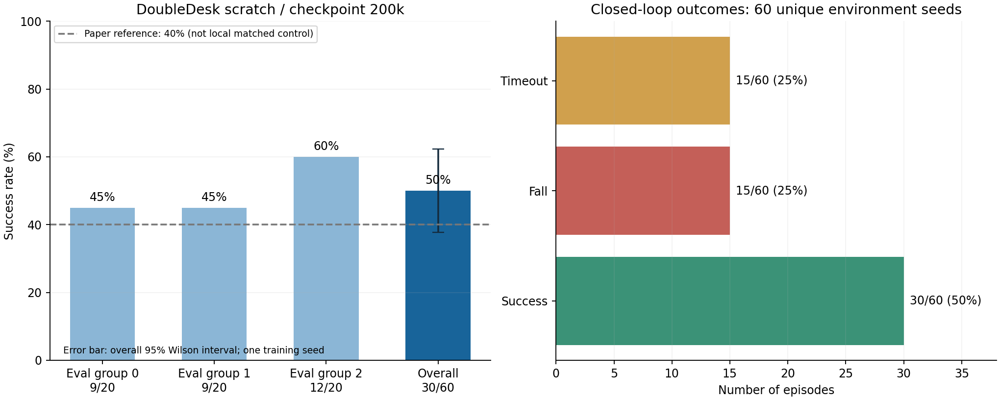
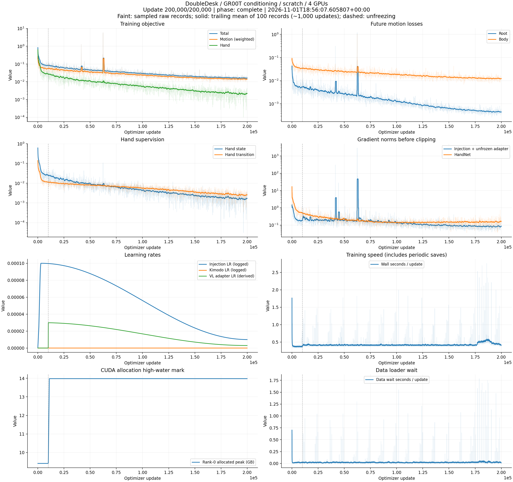

# DoubleDesk 单任务 scratch：GR00T N1.7 图文注入

本目录归档本次实际训练及评估结果。完整过程说明见[实验设计与运行方法](../../benchmarks/arena_groot_n17.md)。

- 分支：`model_improvement_lct1`；训练种子42，四卡、全局batch 64、20万步。
- 成功率：**30/60 = 50%**；三个评估组为45%、45%、60%。
- 失败：15次跌倒、15次超时。60个回合有60个不同环境种子。
- 论文原模型参考40%；本机同配方原模型对照尚缺。本次结果高10个百分点，尚不能据此确认稳定提升。
- 95% Wilson区间约37.7%–62.3%；仅一次独立训练。
- 训练23.14小时，正式评估1.75小时。未加载419h策略checkpoint。

[详细分析](RESULT_ANALYSIS.md) · [评估统计](doubledesk_formal/summary.json) · [训练配置](config.json) · [参数量](validation/groot_parameter_counts.json)

## 训练曲线与指标

[PDF曲线](monitor/training_curves.pdf) · [完整指标CSV](monitor/metrics.csv) · [历史尖峰](monitor/historical_spikes.json) · [分时快照](monitor/snapshots)

## 文件含义与本地资源

- `result_analysis.json`：分析计算结果；`experiment_summary.json`：最终实验摘要。
- `doubledesk_formal/`：逐回合结果、成功率、推理有效性和环境/SONIC资产哈希。
- `validation/`：真实VLM前向/反向及推理预检、四卡解冻与恢复一致性验证、最终流程状态。
- `monitor/`：完整指标、最终曲线、告警记录和每小时快照。

运行记录中的绝对路径和PID保留为本次实验的出处。完整本地run为：
`/root/workspace/kimodo-policy-vlm-version/log/arena_doubledesk_groot/scratch_ddp4_20261101`。
最终权重位于其 `checkpoint_200000/`，恢复状态为 `resume.pt`，均保留在本机。
N1.7、Cosmos和Kimodo预训练权重通过实验文档所述来源准备；本目录保存统计和图表。
归档时训练、评估和实时监控均已完成，xiancun保活已恢复。

## 提交前验证

带本机原仓库运行回归：**67 passed、1 skipped、2 deselected**。
BiGym未安装导致1项跳过；两项修改前已复现的SIMPLE 36D等价问题单独排除。
[验证命令与范围](validation/regression.json) · [测试日志](validation/regression.log)。
