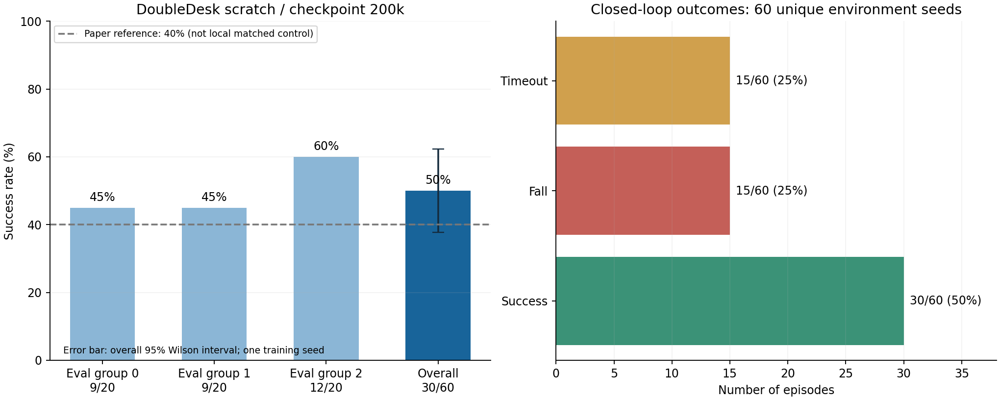

# DoubleDesk / GR00T N1.7 条件注入实验结果分析

训练及评估均已完成。`checkpoint_200000` 在正式60回合中成功30次，成功率 **50%**；论文单任务 scratch 参考值为40%，本次高 **10个百分点**（相对提高25%）。本机同配方原模型尚未训练评估，不能把论文值视为本次配对对照或据此确认架构带来稳定提升。

## 结果及有效性

| 评估组 | 成功 / 总数 | 成功率 | 跌倒 | 超时 |
|---|---:|---:|---:|---:|
| seed 0 | 9/20 | 45% | 6 | 5 |
| seed 1 | 9/20 | 45% | 5 | 6 |
| seed 2 | 12/20 | 60% | 4 | 4 |
| 合计 | 30/60 | 50% | 15 | 15 |

60个回合具有60个不同环境种子，退出码均为0；模型服务有效性检查通过，记录2734次成功推理。环境、SONIC和评估脚本哈希及推理配置保存在 `doubledesk_formal/evaluation_manifest.json`。三个评估组来自**同一个训练种子42**的模型，不能用于估计跨训练种子的方差。

在近似将各环境回合视为独立 Bernoulli 试验的条件下，30/60的95% Wilson区间为 **37.7%–62.3%**，仍覆盖40%。单次60回合是积极初步结果，尚不足以证明稳定优于原模型；未进行与本机对照的配对显著性检验。

## 训练情况

四卡训练20万步耗时 **23.14小时**，正式评估耗时 **1.75小时**。未加载419h策略预训练权重；保留预训练运动先验和N1.7特征权重。前1万步训练新增注入模块及scratch HandNet，之后解冻共享四层适配器；VLM、Kimodo Root/Body保持冻结。

| 训练区间 | 总损失均值 | Root未加权 | Body未加权 | Hand损失 |
|---|---:|---:|---:|---:|
| 1001-10000 | 0.09933 | 0.005806 | 0.03740 | 0.03871 |
| 10001-20000 | 0.07416 | 0.004753 | 0.03267 | 0.02247 |
| 100001-110000 | 0.02807 | 0.001202 | 0.01806 | 0.00520 |
| 190001-200000 | 0.01632 | 0.000454 | 0.01241 | 0.00209 |

所有已记录损失和梯度均有限，最终1000步平均总损失约0.01644，最后1万步约0.01632。约41460及62290–62330步出现过明显瞬时尖峰，最大记录总损失5.94、裁剪前梯度2965.67；梯度裁剪上限为1，随后已恢复，未演变为持续发散。不能仅凭日志判断尖峰的样本来源，若排查需复现实例和数据采样。

最后1万步中，Body未加权损失数值约占总损失 **76.1%**（其权重为1）；Root和Hand数值误差也继续降低。这说明离线拟合仍主要受Body项影响，但损失量纲与闭环失败原因并不一一对应。当前没有验证集曲线，因此不能判断过拟合，也不能从持续下降推断成功率必然持续上升。

## 失败分析

- 15/60跌倒，占全部回合25%、失败回合50%；发生步数中位数753，范围504–1560。闭环运动稳定性仍是明确短板。
- 15/60超时，占全部回合25%、失败回合50%；均达到2000步上限，未完成任务。现有二值奖励和汇总不能区分接近物体、抓取、搬运、放置等阶段。
- 30次成功的结束步数中位数789，范围587–1741。并非全部需要到超时上限才成功。
- 本次关闭视频录制，保留了逐回合日志及VLA动作记录；因此没有足够证据把失败归因于视觉定位、抓握时机或具体身体关节。

## 后续实验优先级

1. 在本机训练原DINOv3+ControlNet的同配方单任务scratch对照，使用相同60个环境种子评估；比较逐回合胜负和跌倒率。这一步优先于宣称模型改进已成立。
2. 用相同种子评估100k/150k/200k checkpoint，检验最终checkpoint是否也是闭环最优，先复用已有模型，避免直接延长训练。
3. 录制有代表性的成功、跌倒和超时回合，结合动作记录定位接近、抓取、搬运、放置及失稳阶段，再决定是否需要改Root/Body注入强度或手部适配。
4. 增加独立训练种子，以及冻结/解冻共享适配器的对照，才能区分VLM条件、适配器联合训练和随机性的贡献。是否进一步微调视觉编码器，由对照与失败回放决定。

## 产物

- `checkpoint_200000/`：最终权重；`resume.pt`：恢复训练状态。
- `doubledesk_formal/summary.json`、`summary.jsonl`：总体和逐回合结果。
- `result_analysis.json`：本报告可核对的计算结果。
- `evaluation_results.png`、`evaluation_results.pdf`：成功率及失败构成图。
- `monitor/training_curves.png`、`monitor/training_curves.pdf`：最终训练曲线。
- `monitor/dashboard.html`：已完成状态的监控面板；后台监控在完成后正常退出。

训练与评估结束后已确认xiancun继续运行并实际计算，最新检查在GPU6保活。
